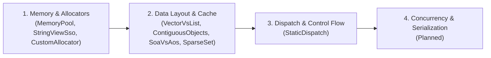

# C++ Lessons

Practical C++20 lessons for game development with runnable examples, tutorials in English and
Brazilian Portuguese, and benchmarks that measure the cost of each approach.

[](https://github.com/LevyArsOS/cpp-lessons/actions/workflows/ci.yml)
[](https://github.com/LevyArsOS/cpp-lessons/releases)
[](LICENSE)
[](https://en.cppreference.com/w/cpp/20)
[](#topics)

## Contents

- [Motivation](#motivation)
- [Topics](#topics)
- [Getting started](#getting-started)
- [Project structure](#project-structure)
- [Contributing](#contributing)
- [License](#license)

## Motivation

This project is motivated by [learning by teaching](https://en.wikipedia.org/wiki/Learning_by_teaching),
in the spirit of the **Feynman technique**: explaining a topic in simple terms to find the gaps in
your own understanding. Each lesson contrasts a naive approach with a cache-friendly, allocation-aware
optimized approach used in game loops, backed by reproducible benchmarks and explanations in both
English and Brazilian Portuguese.

## Topics

Lessons are grouped into progressive hardware optimization learning paths:



### 1. Memory & Allocators

| Lesson | Tutorial | Benchmark | Focus |
|---|---|---|---|
| Memory Pool | [English](lessons/MemoryPool/Tutorial/en.md) · [Português](lessons/MemoryPool/Tutorial/pt-br.md) | [Results](lessons/MemoryPool/Benchmark.md) | Free-list pools & linear arenas vs `new`/`delete` |
| String View & SSO | [English](lessons/StringViewSso/Tutorial/en.md) · [Português](lessons/StringViewSso/Tutorial/pt-br.md) | [Results](lessons/StringViewSso/Benchmark.md) | Zero-alloc lookups (`is_transparent`) & string interning |
| Custom Allocator (`std::pmr`) | [English](lessons/CustomAllocator/Tutorial/en.md) · [Português](lessons/CustomAllocator/Tutorial/pt-br.md) | [Results](lessons/CustomAllocator/Benchmark.md) | `monotonic_buffer_resource` & `unsynchronized_pool_resource` |

### 2. Data Layout & Cache

| Lesson | Tutorial | Benchmark | Focus |
|---|---|---|---|
| Vector vs List | [English](lessons/VectorVsList/Tutorial/en.md) · [Português](lessons/VectorVsList/Tutorial/pt-br.md) | [Results](lessons/VectorVsList/Benchmark.md) | Contiguous traversal & $O(1)$ swap-and-pop removal |
| Contiguous Objects | [English](lessons/ContiguousObjects/Tutorial/en.md) · [Português](lessons/ContiguousObjects/Tutorial/pt-br.md) | [Results](lessons/ContiguousObjects/Benchmark.md) | `std::vector<T>` values vs scattered `unique_ptr<T>` |
| SoA vs AoS | [English](lessons/SoaVsAos/Tutorial/en.md) · [Português](lessons/SoaVsAos/Tutorial/pt-br.md) | [Results](lessons/SoaVsAos/Benchmark.md) | Cache-line density, hot/cold splitting & SIMD |
| Sparse Set | [English](lessons/SparseSet/Tutorial/en.md) · [Português](lessons/SparseSet/Tutorial/pt-br.md) | [Results](lessons/SparseSet/Benchmark.md) | Dense ECS component pools & $O(1)$ swap-and-pop |

### 3. Dispatch & Control Flow

| Lesson | Tutorial | Benchmark | Focus |
|---|---|---|---|
| Static Dispatch | [English](lessons/StaticDispatch/Tutorial/en.md) · [Português](lessons/StaticDispatch/Tutorial/pt-br.md) | [Results](lessons/StaticDispatch/Benchmark.md) | Homogeneous CRTP buckets vs `virtual` vtable dispatch |

### 4. Concurrency & Serialization

Planned track covering lock-free queues, false sharing, and zero-copy binary serialization.


## Getting started

Prerequisite: a C++20 compiler (`g++ >= 13` or `clang++ >= 16`) and CMake `>= 3.24`.

```bash
git clone https://github.com/LevyArsOS/cpp-lessons.git
cd cpp-lessons
scripts/check    # build (warnings as errors) + unit tests
```

## Project structure

Each topic is a lesson under `lessons/<Lesson>/` with practical examples, a tutorial, unit tests,
and benchmarks that compare the approaches.

```text
lessons/<Lesson>/
  include/           naive and optimized header/implementation types
  benchmark.cpp      benchmark runner for the lesson
  Benchmark.md       recorded benchmark results and analysis
  Tutorial/en.md     tutorial in English
  Tutorial/pt-br.md  tutorial in Brazilian Portuguese
tests/<Lesson>/      unit tests for the example types
scripts/check        build and test entry point (also run by CI)
```

## Contributing

Changes land through pull requests to `develop`; see [CONTRIBUTING.md](CONTRIBUTING.md) (including
how to add a lesson) and the shared vocabulary in [GLOSSARY.md](GLOSSARY.md). Report
vulnerabilities privately as described in [SECURITY.md](SECURITY.md).

## License

This project is licensed under the MIT License - see the [LICENSE](LICENSE) file for details.

## Author

**[LevyArsOS](https://github.com/LevyArsOS)**
