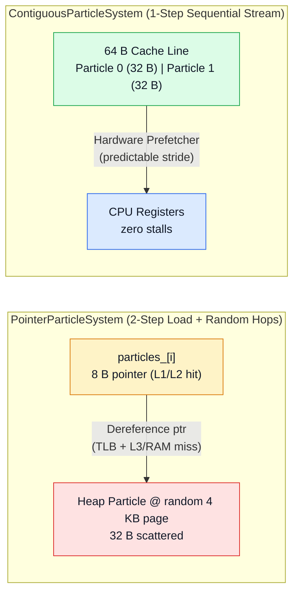

# Contiguous Objects (`std::vector<T>` vs `std::vector<std::unique_ptr<T>>`)

## Table of Contents

- [Intuition: The Warehouse vs. Sticky Notes](#intuition-the-warehouse-vs-sticky-notes)
- [Hardware and Memory Layout](#hardware-and-memory-layout)
- [Step-by-Step Code Walkthrough](#step-by-step-code-walkthrough)
- [Trade-offs and Pitfalls](#trade-offs-and-pitfalls)
- [How to Verify and Profile](#how-to-verify-and-profile)
- [Summary](#summary)

---

## Intuition: The Warehouse vs. Sticky Notes

Suppose you need to inspect 100,000 shipping crates. You have two ways to organize them:

1. **Scattered (`std::vector<std::unique_ptr<Particle>>`)**: You line up 100,000 index cards in a binder. Each card does not hold a crate; it holds an address written on a sticky note pointing to a random shelf somewhere in a giant warehouse. To inspect a crate, you read the card, walk across the warehouse to that shelf, inspect the crate, walk back to the binder, and read the next card.
2. **Contiguous (`std::vector<Particle>`)**: You place all 100,000 crates side by side on a single conveyor belt. As you inspect crate #0, crates #1 and #2 are already rolling into your hands without walking anywhere.

Even when the crates themselves are identical (`32` bytes each), walking to random warehouse shelves on every single item is what stalls the CPU.

---

## Hardware and Memory Layout

When `PointerParticleSystem` iterates `std::vector<std::unique_ptr<Particle>>`, it pays **double indirection** plus **Translation Lookaside Buffer (TLB)** pressure (the TLB is a tiny hardware address-book cache that translates virtual addresses into physical RAM pages; jumping across random pages causes expensive TLB misses):

```text
std::vector<std::unique_ptr<Particle>> (8-byte pointers -> scattered 4 KB OS pages)
[ ptr 0 | ptr 1 | ptr 2 | ... ]
    |       |       +---> 0x7f12_8040 (Heap Page A -> TLB miss + L3/RAM miss)
    |       +-----------> 0x55a0_19c0 (Heap Page B -> TLB miss + L3/RAM miss)
    +-------------------> 0x62b4_f020 (Heap Page C -> TLB miss + L3/RAM miss)

std::vector<Particle> (contiguous 32-byte values)
|<------------------ 64-byte Cache Line ------------------>|
| Particle 0 (32 bytes)        | Particle 1 (32 bytes)     |  --> 2 Particles per cache line!
```



Because `Particle` is 32 bytes (`8` floats), **two** `Particle` structs fit inside every 64-byte cache line, and contiguous memory stays inside far fewer 4 KB virtual memory pages, keeping the TLB hot.

---

## Step-by-Step Code Walkthrough

In [`lessons/ContiguousObjects/include/particle_systems.hpp`](../include/particle_systems.hpp), `Particle` is a 32-byte struct with `step(float dt)`.

### 1. Naive Approach: `PointerParticleSystem`

`PointerParticleSystem` allocates each `Particle` individually with `std::make_unique<Particle>` and shuffles the pointer vector (`scatter_heap = true`) to simulate fragmented heap allocations after gameplay spawns/despawns:

```cpp
void step(float dt, int frames) noexcept {
    for (int f = 0; f < frames; ++f) {
        for (const auto& p : particles_) {
            p->step(dt);
        }
    }
}
```

Even though `particles_` itself is contiguous, `p->step(dt)` must load the pointer, translate its virtual address via the TLB, and wait for a random heap cache line.

### 2. Optimized Approach: `ContiguousParticleSystem`

`ContiguousParticleSystem` stores `std::vector<Particle> particles_` by value and reserves capacity upfront (`particles_.reserve(count)`):

```cpp
void step(float dt, int frames) noexcept {
    for (int f = 0; f < frames; ++f) {
        for (auto& p : particles_) {
            p.step(dt);
        }
    }
}
```

There is zero heap allocation per particle and zero pointer chasing. The hardware prefetcher streams cache lines ahead of the loop.

---

## Trade-offs and Pitfalls

### When NOT to Use `std::vector<T>` by Value

- **Pointer/reference stability required**: `std::vector<T>` relocates elements on reallocation and shifts elements on `erase`. If external systems store raw `T*` pointers, use indices/handles or a slot map.
- **Runtime polymorphism via base class**: `std::vector<Base>` slices derived types (**object slicing**—chopping off derived-class fields when copied by value into a `Base` slot). Use `std::variant`, homogeneous typed buckets, or `std::unique_ptr<Base>` only when true open-set polymorphism is needed.
- **Very large, rarely moved objects**: If `T` is several kilobytes and frequently sorted or reordered, sorting a lightweight index array (`std::vector<std::uint32_t>`) can be cheaper than moving `T`.

---

## How to Verify and Profile

Build and run the benchmark, then measure cache misses and `dTLB-load-misses` with `perf stat`:

```bash
cmake -S . -B build -DCMAKE_BUILD_TYPE=Release
cmake --build build --target contiguous_objects_bench
./build/lessons/ContiguousObjects/contiguous_objects_bench
perf stat -e cache-misses,dTLB-load-misses,L1-dcache-load-misses ./build/lessons/ContiguousObjects/contiguous_objects_bench
```

You can also run `valgrind --tool=cachegrind` to compare L1/LL read misses between `PointerParticleSystem` and `ContiguousParticleSystem`.

---

## Summary

Workload: `100,000` `Particle` objects (`32` bytes each) stepped for `60` frames (`dt = 0.016f`, `g++ 13.3.0 -O2`, Ryzen 7 5800X):

| Metric | `PointerParticleSystem` (`unique_ptr`) | `ContiguousParticleSystem` (`vector<Particle>`) |
|---|---:|---:|
| Total Time (`60` frames) | `21.188 ms` | `7.357 ms` (`2.88x` faster) |
| Heap allocations (`100k` items) | `100,001` (`1` vector + `100k` nodes) | `1` (single contiguous buffer) |
| Particles per 64 B cache line | Scattered (1 miss per particle) | `2` particles per cache line |
| Pointer indirections per `step` | `1` (`p->...`) | `0` |
| Pointer stability across `push_back` | Yes | No (use handles/indices) |
