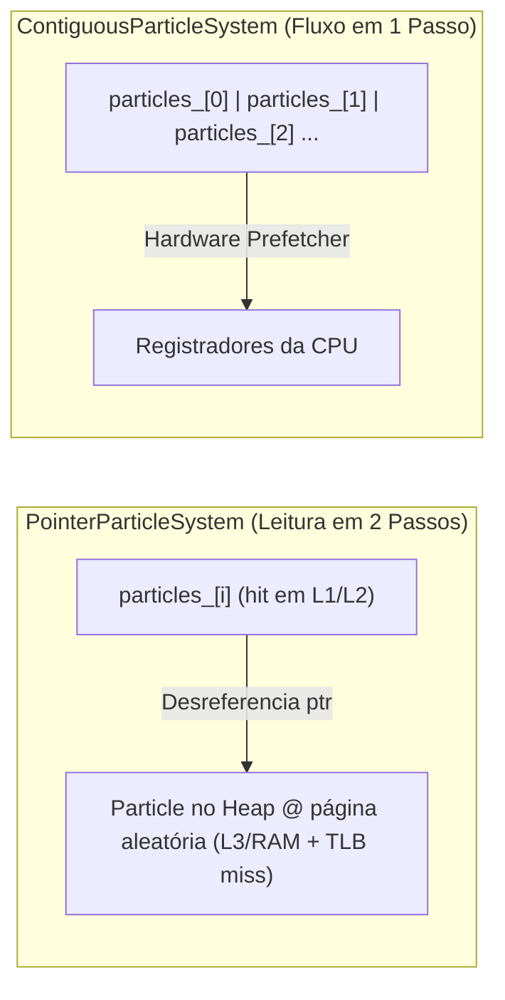

# Objetos Contíguos (`std::vector<T>` vs `std::vector<std::unique_ptr<T>>`)

## Índice

- [Intuição: O Galpão vs. Bilhetes Adesivos](#intuição-o-galpão-vs-bilhetes-adesivos)
- [Hardware e Layout de Memória](#hardware-e-layout-de-memória)
- [Passo a Passo do Código](#passo-a-passo-do-código)
- [Trade-offs e Armadilhas](#trade-offs-e-armadilhas)
- [Como Verificar e Fazer Profiling](#como-verificar-e-fazer-profiling)
- [Resumo](#resumo)

---

## Intuição: O Galpão vs. Bilhetes Adesivos

Imagine que você precisa inspecionar 100.000 caixas de carga. Existem duas formas de organizá-las:

1. **Espalhadas (`std::vector<std::unique_ptr<Particle>>`)**: Você coloca 100.000 fichas em um fichário. Cada ficha não contém a caixa; ela contém um endereço anotado em um bilhete apontando para uma prateleira aleatória em um galpão gigante. Para inspecionar uma caixa, você lê a ficha, anda pelo galpão até a prateleira, olha a caixa, volta ao fichário e lê a próxima ficha.
2. **Contíguas (`std::vector<Particle>`)**: Você coloca todas as 100.000 caixas lado a lado em uma única esteira rolante. Enquanto você inspeciona a caixa #0, as caixas #1 e #2 já estão chegando às suas mãos sem você sair do lugar.

Mesmo quando as caixas são idênticas (`32` bytes cada), caminhar até prateleiras aleatórias a cada item é o que trava a CPU.

---

## Hardware e Layout de Memória

Quando `PointerParticleSystem` itera `std::vector<std::unique_ptr<Particle>>`, ele paga **dupla indireção** além de pressão no **Translation Lookaside Buffer (TLB)**:

```text
std::vector<std::unique_ptr<Particle>> (ponteiros de 8 bytes -> páginas de 4 KB espalhadas)
[ ptr 0 | ptr 1 | ptr 2 | ... ]
    |       |       +---> 0x7f12_8040 (Página Heap A -> TLB miss + L3/RAM miss)
    |       +-----------> 0x55a0_19c0 (Página Heap B -> TLB miss + L3/RAM miss)
    +-------------------> 0x62b4_f020 (Página Heap C -> TLB miss + L3/RAM miss)

std::vector<Particle> (valores contíguos de 32 bytes)
|<------------------ Cache Line de 64 bytes ------------------>|
| Particle 0 (32 bytes)        | Particle 1 (32 bytes)     |  --> 2 Partículas por cache line!
```



Como `Particle` tem 32 bytes (`8` floats), **duas** structs `Particle` cabem em cada cache line de 64 bytes, e a memória contígua ocupa muito menos páginas virtuais de 4 KB, mantendo o TLB aquecido.

---

## Passo a Passo do Código

Em [`lessons/ContiguousObjects/include/particle_systems.hpp`](../include/particle_systems.hpp), `Particle` é uma struct de 32 bytes com `step(float dt)`.

### 1. Abordagem Ingênua: `PointerParticleSystem`

`PointerParticleSystem` aloca cada `Particle` individualmente com `std::make_unique<Particle>` e embaralha o vetor de ponteiros (`scatter_heap = true`) para simular fragmentação de heap após criações e remoções em runtime:

```cpp
void step(float dt, int frames) noexcept {
    for (int f = 0; f < frames; ++f) {
        for (const auto& p : particles_) {
            p->step(dt);
        }
    }
}
```

Mesmo que `particles_` seja contíguo, `p->step(dt)` precisa carregar o ponteiro, traduzir seu endereço virtual no TLB e esperar uma linha de cache aleatória do heap.

### 2. Abordagem Otimizada: `ContiguousParticleSystem`

`ContiguousParticleSystem` armazena `std::vector<Particle> particles_` por valor e reserva a capacidade antecipadamente (`particles_.reserve(count)`):

```cpp
void step(float dt, int frames) noexcept {
    for (int f = 0; f < frames; ++f) {
        for (auto& p : particles_) {
            p.step(dt);
        }
    }
}
```

Há zero alocações individuais no heap e zero pointer chasing. O prefetcher de hardware traz as próximas linhas de cache antes mesmo de o loop precisar delas.

---

## Trade-offs e Armadilhas

### Quando NÃO Usar `std::vector<T>` por Valor

- **Estabilidade de ponteiro/referência obrigatória**: `std::vector<T>` realoca elementos ao crescer e desloca elementos em `erase`. Se outros sistemas guardam `T*` diretamente, prefira índices/handles ou um slot map.
- **Polimorfismo em tempo de execução via classe base**: `std::vector<Base>` causa *object slicing* em tipos derivados. Use `std::variant`, buckets homogêneos ou `std::unique_ptr<Base>` apenas quando polimorfismo aberto for indispensável.
- **Objetos muito grandes raramente movidos**: Se `T` tiver vários kilobytes e for reordenado com frequência, ordenar um vetor leve de índices (`std::vector<std::uint32_t>`) pode ser mais barato do que mover `T`.

---

## Como Verificar e Fazer Profiling

Compile e execute o benchmark e meça cache misses e `dTLB-load-misses` com `perf stat`:

```bash
cmake -S . -B build -DCMAKE_BUILD_TYPE=Release
cmake --build build --target contiguous_objects_bench
./build/lessons/ContiguousObjects/contiguous_objects_bench
perf stat -e cache-misses,dTLB-load-misses,L1-dcache-load-misses ./build/lessons/ContiguousObjects/contiguous_objects_bench
```

Você também pode rodar `valgrind --tool=cachegrind` para comparar as faltas de leitura em L1/LL entre `PointerParticleSystem` e `ContiguousParticleSystem`.

---

## Resumo

Carga: `100.000` objetos `Particle` (`32` bytes cada) simulados por `60` frames (`dt = 0.016f`, `g++ 13.3.0 -O2`, Ryzen 7 5800X):

| Métrica | `PointerParticleSystem` (`unique_ptr`) | `ContiguousParticleSystem` (`vector<Particle>`) |
|---|---:|---:|
| Tempo total (`60` frames) | `21.188 ms` | `7.357 ms` (`2.88x` mais rápido) |
| Alocações no heap (`100k` itens) | `100.001` (`1` vetor + `100k` nós) | `1` (buffer contíguo único) |
| Partículas por cache line de 64 B | Espalhadas (1 miss por partícula) | `2` partículas por cache line |
| Indireções de ponteiro por `step` | `1` (`p->...`) | `0` |
| Estabilidade de ponteiro em `push_back` | Sim | Não (use handles/índices) |
