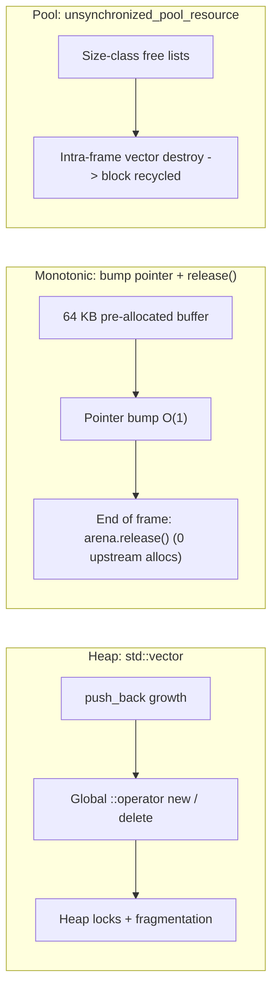

# Custom STL Allocators with `std::pmr` in C++20

## Table of Contents

- [Introduction](#introduction)
- [What Actually Happens Under the Hood?](#what-actually-happens-under-the-hood)
- [Step-by-Step Code Walkthrough](#step-by-step-code-walkthrough)
  - [1. `HeapFrameBuilder` (`std::vector` Baseline)](#1-heapframebuilder-stdvector-baseline)
  - [2. `MonotonicFrameBuilder` (`monotonic_buffer_resource`)](#2-monotonicframebuilder-monotonic_buffer_resource)
  - [3. `PoolFrameBuilder` (`unsynchronized_pool_resource`)](#3-poolframebuilder-unsynchronized_pool_resource)
- [Benchmark Results](#benchmark-results)
- [Common Pitfalls & When NOT to Use This](#common-pitfalls--when-not-to-use-this)
- [How to Diagnose Allocator Contention](#how-to-diagnose-allocator-contention)
- [Summary Comparison](#summary-comparison)

---

## Introduction

Per-frame subsystems (broadphase collision queries, UI draw-command builders, pathfinding scratch lists) routinely construct temporary `std::vector<T>` containers. Even when each vector holds only 24 items, dynamic growth via `push_back` invokes `::operator new` and `::operator delete` multiple times per vector.

C++17's `<memory_resource>` (`std::pmr`) lets you keep standard `std::pmr::vector<T>` ergonomics while swapping the underlying allocator at runtime to a **bump-pointer scratch arena** (`monotonic_buffer_resource`) or a **size-class pool** (`unsynchronized_pool_resource`).

---

## What Actually Happens Under the Hood?

1. **`std::pmr::monotonic_buffer_resource`**: Wraps a fixed stack/pre-allocated buffer (`std::array<std::byte, 65536>`). Allocation advances an offset pointer in a few CPU instructions. `deallocate()` is a **no-op**, and `arena_.release()` resets the entire arena in $O(1)$ at the end of the frame.
2. **`std::pmr::unsynchronized_pool_resource`**: Groups allocations into size-class free lists. When a `std::pmr::vector` grows or goes out of scope mid-frame, freed blocks are recycled immediately for subsequent vectors.



---

## Step-by-Step Code Walkthrough

### 1. `HeapFrameBuilder` (`std::vector` Baseline)

In [pmr_frame_scratch.hpp](../include/pmr_frame_scratch.hpp), `HeapFrameBuilder` constructs 64 temporary `std::vector<DrawCommand>` instances per frame with `std::allocator`.

### 2. `MonotonicFrameBuilder` (`monotonic_buffer_resource`)

`MonotonicFrameBuilder` passes `&arena_` to `std::pmr::vector<DrawCommand>(&arena_)` and resets once per frame:

```cpp
for (uint32_t b = 0; b < buckets; ++b) {
    std::pmr::vector<DrawCommand> cmds(&arena_);
    checksum += fill_commands(cmds, b, items_per_bucket);
}
arena_.release();
```

In our unit test with `CountingResource(std::pmr::null_memory_resource())`, 500 frames complete with **0 upstream allocations**.

### 3. `PoolFrameBuilder` (`unsynchronized_pool_resource`)

`PoolFrameBuilder` backs `std::pmr::vector` with `std::pmr::unsynchronized_pool_resource`. After the first frame populates the pool's size-class chunks, 100 subsequent frames execute with **0 new upstream allocations**, even without calling `release()`.

---

## Benchmark Results

Measured with `./build/CustomAllocator_benchmark` (`g++ 13.3.0 -std=c++20 -O2`) over 1,000 frames x 64 dynamic vectors x 24 items:

| Allocator | Time (ms) | Speedup | Checksum |
|---|---:|---:|---:|
| `std::vector` (default heap) | 7.930 | 1.00x | 4867584000 |
| `std::pmr::unsynchronized_pool_resource` | 9.564 | 0.83x | 4867584000 |
| `std::pmr::monotonic_buffer_resource` + `release()` | **4.908** | **1.62x** | 4867584000 |

---

## Common Pitfalls & When NOT to Use This

- **NEVER forget `release()` on a `monotonic_buffer_resource`:** Because `do_deallocate` is a no-op, using a monotonic arena for long-lived or growing-without-reset containers will exhaust the buffer and spill to upstream heap allocations.
- **Do NOT share `unsynchronized_pool_resource` across threads:** Use `synchronized_pool_resource` or one thread-local arena per worker thread.
- **Watch out for `pmr` pointer size:** Every `std::pmr::vector` stores an extra `memory_resource*` (`+8` bytes on 64-bit). Avoid storing millions of tiny `pmr::vector`s inside long-lived structs.

---

## How to Diagnose Allocator Contention

1. **Wrap upstream with `CountingResource` or `std::pmr::null_memory_resource()`** in tests to catch unexpected heap spills immediately via `std::bad_alloc`.
2. **Profile with `heaptrack` or `perf record`:** Look for `malloc`/`free` hotspots inside frame-tick subsystems.

---

## Summary Comparison

| Criterion | `std::vector` (Heap) | `pmr::unsynchronized_pool` | `pmr::monotonic_buffer + release()` |
|---|---|---|---|
| Upstream heap traffic | Every frame growth | **0 after warmup** | **0 (when within buffer)** |
| Intra-frame deallocation | Returns to global heap | **Recycled in size-class pool** | No-op until `release()` |
| Frame-scratch speed | 7.930 ms | 9.564 ms | **4.908 ms (1.62x faster)** |
| Ideal lifetime | Unbounded / long-lived | Mixed intra-frame churn | Single-frame / scoped scratch |
