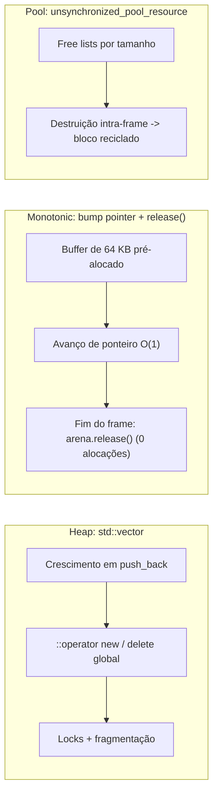

# Alocadores Customizados na STL com `std::pmr` em C++20

## Índice

- [Introdução](#introdução)
- [O Que Realmente Acontece por Baixo dos Panos?](#o-que-realmente-acontece-por-baixo-dos-panos)
- [Passo a Passo do Código](#passo-a-passo-do-código)
  - [1. `HeapFrameBuilder` (Baseline com `std::vector`)](#1-heapframebuilder-baseline-com-stdvector)
  - [2. `MonotonicFrameBuilder` (`monotonic_buffer_resource`)](#2-monotonicframebuilder-monotonic_buffer_resource)
  - [3. `PoolFrameBuilder` (`unsynchronized_pool_resource`)](#3-poolframebuilder-unsynchronized_pool_resource)
- [Resultados do Benchmark](#resultados-do-benchmark)
- [Armadilhas Comuns e Quando NÃO Usar](#armadilhas-comuns-e-quando-não-usar)
- [Como Diagnosticar Contenção de Alocador](#como-diagnosticar-contenção-de-alocador)
- [Tabela Resumo Comparativa](#tabela-resumo-comparativa)

---

## Introdução

Subsistemas executados por frame (consultas de colisão, listas de draw commands de UI, buffers de pathfinding) criam `std::vector<T>` temporários o tempo todo. Mesmo com poucos elementos, o crescimento dinâmico via `push_back` chama `::operator new` e `::operator delete` centenas de vezes por frame.

O cabeçalho `<memory_resource>` (`std::pmr`) do C++17 permite manter a interface de `std::pmr::vector<T>` trocando a estratégia de alocação em tempo de execução para uma **arena bump-pointer** (`monotonic_buffer_resource`) ou um **pool por classe de tamanho** (`unsynchronized_pool_resource`).

---

## O Que Realmente Acontece por Baixo dos Panos?

1. **`std::pmr::monotonic_buffer_resource`**: Usa um buffer pré-alocado na stack (`std::array<std::byte, 65536>`). Alocar apenas avança um ponteiro em poucos ciclos. `deallocate()` não faz nada (no-op), e `arena_.release()` reseta tudo em $O(1)$ ao fim do frame.
2. **`std::pmr::unsynchronized_pool_resource`**: Mantém free lists separadas por tamanho. Quando um `std::pmr::vector` cresce ou é destruído no meio do frame, os blocos liberados são reciclados imediatamente.



---

## Passo a Passo do Código

### 1. `HeapFrameBuilder` (Baseline com `std::vector`)

Em [pmr_frame_scratch.hpp](../include/pmr_frame_scratch.hpp), `HeapFrameBuilder` cria 64 `std::vector<DrawCommand>` temporários por frame usando o alocador padrão.

### 2. `MonotonicFrameBuilder` (`monotonic_buffer_resource`)

`MonotonicFrameBuilder` passa `&arena_` para `std::pmr::vector<DrawCommand>(&arena_)` e reseta uma vez por frame:

```cpp
for (uint32_t b = 0; b < buckets; ++b) {
    std::pmr::vector<DrawCommand> cmds(&arena_);
    checksum += fill_commands(cmds, b, items_per_bucket);
}
arena_.release();
```

Nos testes com `CountingResource(std::pmr::null_memory_resource())`, 500 frames executam com **0 alocações no heap**.

### 3. `PoolFrameBuilder` (`unsynchronized_pool_resource`)

`PoolFrameBuilder` usa `std::pmr::unsynchronized_pool_resource`. Após o primeiro frame aquecer os pools, 100 frames seguintes executam com **0 novas alocações upstream**, mesmo sem chamar `release()`.

---

## Resultados do Benchmark

Medido com `./build/CustomAllocator_benchmark` (`g++ 13.3.0 -std=c++20 -O2`) em 1.000 frames x 64 vetores dinâmicos x 24 itens:

| Alocador | Tempo (ms) | Speedup | Checksum |
|---|---:|---:|---:|
| `std::vector` (heap padrão) | 7.930 | 1.00x | 4867584000 |
| `std::pmr::unsynchronized_pool_resource` | 9.564 | 0.83x | 4867584000 |
| `std::pmr::monotonic_buffer_resource` + `release()` | **4.908** | **1.62x** | 4867584000 |

---

## Armadilhas Comuns e Quando NÃO Usar

- **NUNCA esqueça `release()` em `monotonic_buffer_resource`:** Como `do_deallocate` é no-op, usar arena monotônica em containers de longa duração sem reset esgota o buffer e cai para o heap.
- **NÃO compartilhe `unsynchronized_pool_resource` entre threads:** Use `synchronized_pool_resource` ou uma arena `thread_local` por worker.
- **Atenção ao ponteiro extra do `pmr`:** Cada `std::pmr::vector` guarda um `memory_resource*` (`+8` bytes em 64 bits).

---

## Como Diagnosticar Contenção de Alocador

1. **Injete `CountingResource` ou `std::pmr::null_memory_resource()`** nos testes para detectar qualquer escape para o heap via `std::bad_alloc`.
2. **Profile com `heaptrack` ou `perf record`:** Procure chamadas a `malloc`/`free` dentro do loop de frame.

---

## Tabela Resumo Comparativa

| Critério | `std::vector` (Heap) | `pmr::unsynchronized_pool` | `pmr::monotonic_buffer + release()` |
|---|---|---|---|
| Tráfego no heap | Todo crescimento | **0 após warmup** | **0 (dentro do buffer)** |
| Desalocação intra-frame | Volta ao heap global | **Reciclado no pool** | No-op até `release()` |
| Velocidade de scratch | 7.930 ms | 9.564 ms | **4.908 ms (1.62x mais rápido)** |
| Uso ideal | Vida longa / ilimitada | Churn misto intra-frame | Scratch por frame / escopo |
