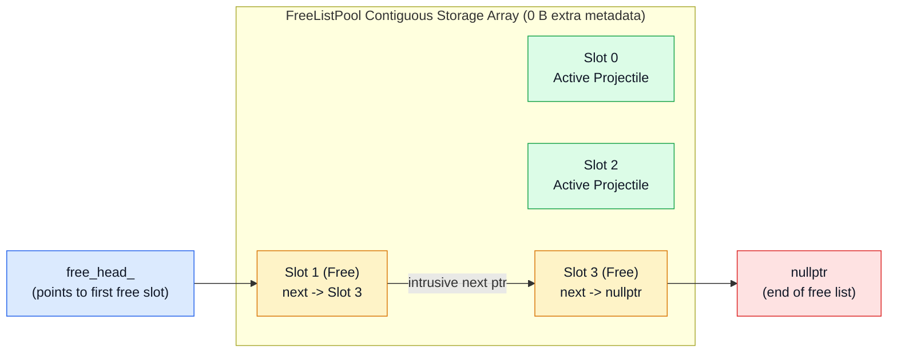

# Memory Pool vs. Dynamic Allocation (`new`/`delete`)

## Table of Contents

- [Intuition: Filling Out Lease Paperwork vs. Pre-Assigned Cubbies](#intuition-filling-out-lease-paperwork-vs-pre-assigned-cubbies)
- [Hardware and Memory Layout](#hardware-and-memory-layout)
- [Step-by-Step Code Walkthrough](#step-by-step-code-walkthrough)
  - [1. Naive Approach: `NaiveSpawner` (`new` / `delete`)](#1-naive-approach-naivespawner-new--delete)
  - [2. Intrusive Free-List: `FreeListPool` & `PoolSpawner`](#2-intrusive-free-list-freelistpool--poolspawner)
  - [3. Linear Bump Allocator: `ArenaAllocator` & `ArenaSpawner`](#3-linear-bump-allocator-arenaallocator--arenaspawner)
- [Trade-offs and Pitfalls](#trade-offs-and-pitfalls)
- [How to Verify and Profile](#how-to-verify-and-profile)
- [Summary](#summary)

---

## Intuition: Filling Out Lease Paperwork vs. Pre-Assigned Cubbies

In a real-time game, thousands of bullets, particles, and hit sparks spawn and vanish every second. Calling `new` and `delete` for every single projectile is like **renting a separate downtown office** every time a sticky note needs to be written:

1. **Dynamic Heap (`new` / `delete`)**: You walk to the city clerk (`malloc`/`free`), wait in line behind other threads (allocator locks), sign a 16-byte deed (chunk metadata), and get handed a random room anywhere in the city. When the bullet hits a wall two frames later, you go back to cancel the lease.
2. **Free-List Object Pool (`FreeListPool`)**: Before the match starts, you buy one hallway of 1,000 numbered lockers. Any empty locker holds a note inside it saying which locker is empty next (`free_head_`). When a bullet spawns, you grab the first empty locker in $O(1)$ without talking to the city clerk.
3. **Linear Arena (`ArenaAllocator`)**: You lay out a giant roll of butcher paper and just move a pencil mark forward (`offset_ += size`) for each new bullet. When the whole wave ends, you rip off the sheet in one motion (`offset_ = 0`)—no individual erasures needed.

---

## Hardware and Memory Layout

Calling `new` invokes the OS/runtime heap allocator (e.g., glibc `malloc`):
- **Lock Contention**: General-purpose allocators must be thread-safe, acquiring internal locks or managing per-thread arenas.
- **Metadata Overhead**: Each heap block carries an 8- to 16-byte header recording its size and state.
- **Cache Misses**: Objects allocated over time land on scattered memory pages, defeating sequential CPU cache prefetching.

An **intrusive free-list** avoids extra metadata completely by using a `union Slot`: while a slot is *free*, its bytes store a `Slot* next` pointer; when *active*, **placement new** (`::new (slot->storage) T(...)`) constructs the object directly inside those same bytes:



---

## Step-by-Step Code Walkthrough

All three strategies live in [`lessons/MemoryPool/include/`](../include/free_list_pool.hpp).

### 1. Naive Approach: `NaiveSpawner` (`new` / `delete`)

In [`naive_spawner.hpp`](../include/naive_spawner.hpp), every spawned projectile calls `new Projectile(...)` and every expired projectile calls `delete p`. Across `50,000` spawn/update/free cycles, the allocator executes `50,000` individual heap round-trips (`0.89 ms`, `17.81 ns/op`).

### 2. Intrusive Free-List: `FreeListPool` & `PoolSpawner`

In [`free_list_pool.hpp`](../include/free_list_pool.hpp), `FreeListPool<T, Capacity>` preallocates `Slot slots_[Capacity]`. Allocating pops `free_head_` and constructs `T` in-place via **placement new** (constructing an object at an already-allocated memory address without calling `malloc`):

```cpp
Slot* slot = free_head_;
free_head_ = slot->next;
--available_;
return ::new (static_cast<void*>(slot->storage)) T(std::forward<Args>(args)...);
```

Deallocating runs the destructor manually and pushes the slot back onto `free_head_` in $O(1)$ (`0.29 ms`, `5.71 ns/op`, **3.1x faster**):

```cpp
ptr->~T();
auto* slot = reinterpret_cast<Slot*>(ptr);
slot->next = free_head_;
free_head_ = slot;
```

### 3. Linear Bump Allocator: `ArenaAllocator` & `ArenaSpawner`

In [`arena_allocator.hpp`](../include/arena_allocator.hpp), `ArenaAllocator<Bytes>` maintains a single aligned `buffer_` and an `offset_`. `allocate(size, alignment)` rounds `current` up to the required alignment, checks `offset_ + padding + size <= Bytes`, and bumps `offset_`. `reset()` sets `offset_ = 0` in $O(1)$ (`0.24 ms`, `4.86 ns/op`, **3.7x faster**).

---

## Trade-offs and Pitfalls

### When NOT to Use Pools or Arenas

- **Unbounded or unpredictable object counts**: A fixed-size `FreeListPool<T, Capacity>` returns `nullptr` once full. If you cannot bound the maximum count, back the pool with a linked list of chunked blocks.
- **Individual frees needed with an Arena**: `ArenaAllocator` cannot free a single object early—it only frees everything at once on `reset()`. If objects die in random order, use `FreeListPool`.
- **Non-trivial destructors in an Arena**: `ArenaAllocator::reset()` resets `offset_ = 0` without calling `~T()` on allocated objects. Only use it for trivially destructible types (like `Projectile`), or track destructors separately.
- **Dangling pointers across `reset()`**: Holding a `T*` after `reset()` or `deallocate()` causes silent memory corruption; pair pools with generational handles if external systems keep references.

---

## How to Verify and Profile

Build and run the benchmark, then verify zero steady-state heap allocations with `heaptrack` or `perf stat`:

```bash
cmake -S . -B build -DCMAKE_BUILD_TYPE=Release
cmake --build build --target memory_pool_bench
./build/lessons/MemoryPool/memory_pool_bench
perf stat -e cache-misses,L1-dcache-load-misses,instructions ./build/lessons/MemoryPool/memory_pool_bench
```

To catch out-of-bounds writes or use-after-free bugs during development, run tests under AddressSanitizer (`-fsanitize=address,undefined`).

---

## Summary

Workload: `50,000` `Projectile` spawn/update/free cycles (`g++ 13.3.0 -O2`, Ryzen 7 5800X):

| Allocator Strategy | Total Time | Latency per Op | Speedup vs Baseline | Steady-State Heap Allocs |
|---|---:|---:|---:|---:|
| Naive `new` / `delete` (`NaiveSpawner`) | `0.89 ms` | `17.81 ns/op` | `1.00x` | `50,000` |
| `FreeListPool` (`PoolSpawner`) | `0.29 ms` | `5.71 ns/op` | `3.1x` faster (`0.32x` time) | **0** |
| `ArenaAllocator` (`ArenaSpawner`) | `0.24 ms` | `4.86 ns/op` | `3.7x` faster (`0.27x` time) | **0** |
