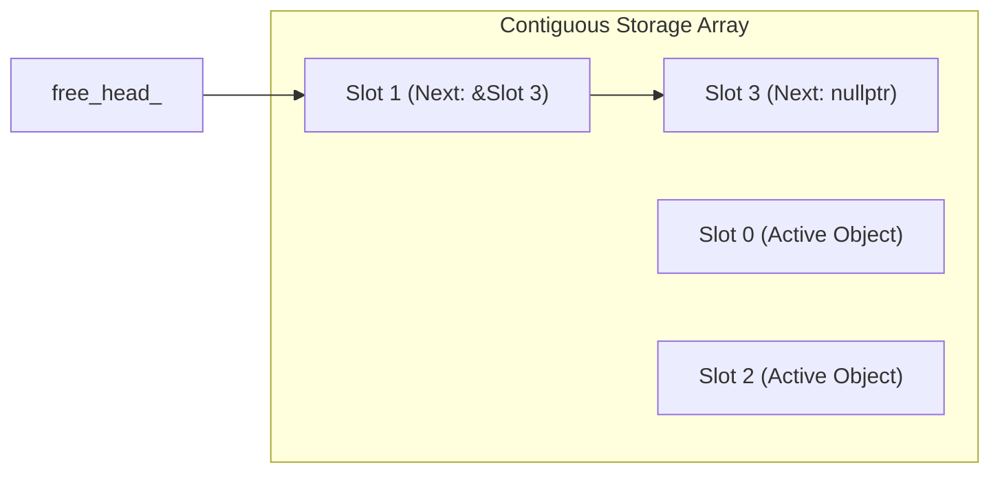

# Memory Pool vs Dynamic Allocation

## Table of Contents

- [Introduction](#introduction)
- [The Hidden Cost of `new` and `delete`](#the-hidden-cost-of-new-and-delete)
- [Free-List Object Pool](#free-list-object-pool)
- [Linear Arena (Bump) Allocator](#linear-arena-bump-allocator)
- [Architectural Comparison](#architectural-comparison)
- [Best Practices in Game Loops](#best-practices-in-game-loops)
- [Summary](#summary)

---

## Introduction

In real-time game development, high-frequency gameplay elements such as bullets, particle effects, and transient events spawn and despawn continuously. Allocating each object individually via `new` and `delete` introduces allocator lock overhead, heap fragmentation, and cache thrashing.

---

## The Hidden Cost of `new` and `delete`

Calling `new` invokes the runtime allocator (e.g., glibc `malloc` or jemalloc):

1. **Lock Contention**: The general-purpose heap is thread-safe, meaning calls must acquire internal allocator mutexes or navigate arena locks.
2. **Metadata Overhead**: Every allocated chunk stores internal metadata (typically 8 to 16 bytes per chunk) to record size and allocation state.
3. **Cache Misses**: Objects allocated over time become scattered non-contiguously across virtual memory, defeating hardware cache line prefetching.

---

## Free-List Object Pool

A free-list pool preallocates a contiguous block of memory sized for a fixed maximum number of instances. Unallocated slots are linked together using an intrusive pointer inside the unused memory slot itself:



### Allocation: O(1)
Pop the first slot from `free_head_` and construct the object in-place using placement new:
```cpp
Slot* slot = free_head_;
free_head_ = slot->next;
return ::new (slot->storage) T(args...);
```

### Deallocation: O(1)
Invoke the object's destructor and push the slot back onto the free list:
```cpp
ptr->~T();
auto* slot = reinterpret_cast<Slot*>(ptr);
slot->next = free_head_;
free_head_ = slot;
```

---

## Linear Arena (Bump) Allocator

An arena allocator reserves a fixed byte buffer and advances a simple offset index whenever memory is requested. Individual deallocations are disabled; instead, the entire arena resets its offset to zero at the end of a frame or burst cycle.

- **Allocation**: Returns aligned pointer at `buffer + offset`, then adds size to `offset`.
- **Reset**: Sets `offset = 0` in O(1) time.

Ideal for per-frame scratch memory or level-lifetime temporary entities.

---

## Architectural Comparison

| Metric | `new` / `delete` | Free-List Pool | Arena Allocator |
|---|---|---|---|
| Allocation Time | Variable (heap traversal) | O(1) guaranteed | O(1) pointer bump |
| Deallocation Time | Variable (heap merging) | O(1) free-list push | O(0) / bulk reset O(1) |
| Runtime Heap Calls | 1 per object | **0** | **0** |
| Memory Overhead | 16 B per chunk | 0 B (intrusive) | 0 B |
| Memory Locality | Scattered | High (contiguous array) | Maximum (packed buffer) |

---

## Best Practices in Game Loops

1. **Preallocate during load time**: Allocate pools and arenas before entering simulation loops to prevent allocation spikes during gameplay.
2. **Use intrusive free lists for random lifetimes**: If entities can despawn in arbitrary order, use free-list pools.
3. **Use arenas for grouped lifetimes**: If entities share a common lifetime (e.g., cleared at frame end or wave end), use linear arenas.
