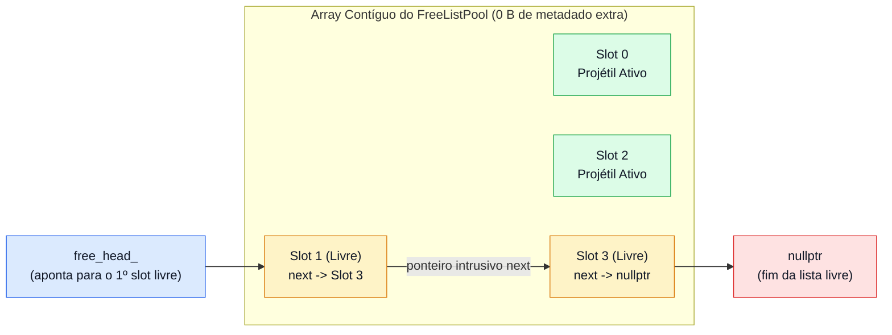

# Memory Pool vs. Alocação Dinâmica (`new`/`delete`)

## Índice

- [Intuição: Assinar Contrato Todo Dia vs. Armários Pré-Alocados](#intuição-assinar-contrato-todo-dia-vs-armários-pré-alocados)
- [Hardware e Layout de Memória](#hardware-e-layout-de-memória)
- [Passo a Passo do Código](#passo-a-passo-do-código)
  - [1. Abordagem Ingênua: `NaiveSpawner` (`new` / `delete`)](#1-abordagem-ingênua-naivespawner-new--delete)
  - [2. Free-List Intrusiva: `FreeListPool` e `PoolSpawner`](#2-free-list-intrusiva-freelistpool-e-poolspawner)
  - [3. Alocador Linear (Bump): `ArenaAllocator` e `ArenaSpawner`](#3-alocador-linear-bump-arenaallocator-e-arenaspawner)
- [Trade-offs e Armadilhas](#trade-offs-e-armadilhas)
- [Como Verificar e Fazer Profiling](#como-verificar-e-fazer-profiling)
- [Resumo](#resumo)

---

## Intuição: Assinar Contrato Todo Dia vs. Armários Pré-Alocados

Em um jogo em tempo real, milhares de projéteis, partículas e faíscas surgem e desaparecem a cada segundo. Chamar `new` e `delete` para cada projétil é como **alugar uma sala comercial separada** toda vez que você precisa anotar um lembrete:

1. **Heap Dinâmica (`new` / `delete`)**: Você vai até o cartório (`malloc`/`free`), espera na fila atrás de outras threads (travas do alocador), assina um registro de 16 bytes (metadados do bloco) e recebe uma sala aleatória na cidade. Dois frames depois, quando a bala bate na parede, você volta para encerrar o contrato.
2. **Pool com Free-List (`FreeListPool`)**: Antes da partida começar, você compra um corredor com 1.000 armários numerados. Cada armário vazio guarda um bilhete dizendo qual é o próximo armário livre (`free_head_`). Quando um projétil nasce, você pega o primeiro armário livre em $O(1)$ sem falar com o cartório.
3. **Arena Linear (`ArenaAllocator`)**: Você desenrola um rolo gigante de papel pardo e apenas avança a marca do lápis (`offset_ += size`) a cada novo projétil. Quando a onda termina, você arranca a folha inteira de uma vez (`offset_ = 0`) — sem apagar item por item.

---

## Hardware e Layout de Memória

Chamar `new` invoca o alocador geral do sistema (como `malloc` da glibc):
- **Contenção de Travas (Locks)**: Alocadores gerais são thread-safe e precisam adquirir travas internas ou gerenciar arenas por thread.
- **Sobrecarga de Metadados**: Cada bloco no heap guarda um cabeçalho de 8 a 16 bytes com seu tamanho e estado.
- **Cache Misses**: Objetos alocados ao longo do tempo ficam espalhados em páginas aleatórias de memória, quebrando o prefetching sequencial da CPU.

Uma **free-list intrusiva** elimina metadados extras usando uma `union Slot`: enquanto o slot está *livre*, seus bytes guardam o ponteiro `Slot* next`; quando *ativo*, o **placement new** (`::new (slot->storage) T(...)`) constrói o objeto diretamente dentro desses mesmos bytes:



---

## Passo a Passo do Código

Todas as três estratégias estão em [`lessons/MemoryPool/include/`](../include/free_list_pool.hpp).

### 1. Abordagem Ingênua: `NaiveSpawner` (`new` / `delete`)

Em [`naive_spawner.hpp`](../include/naive_spawner.hpp), cada projétil criado chama `new Projectile(...)` e cada projétil expirado chama `delete p`. Em `50.000` ciclos de criação/atualização/liberação, o alocador executa `50.000` viagens individuais ao heap (`0.89 ms`, `17.81 ns/op`).

### 2. Free-List Intrusiva: `FreeListPool` e `PoolSpawner`

Em [`free_list_pool.hpp`](../include/free_list_pool.hpp), `FreeListPool<T, Capacity>` pré-aloca `Slot slots_[Capacity]`. Alocar remove o topo de `free_head_` e constrói `T` no local via **placement new** (construir um objeto em um endereço já alocado, sem chamar `malloc`):

```cpp
Slot* slot = free_head_;
free_head_ = slot->next;
--available_;
return ::new (static_cast<void*>(slot->storage)) T(std::forward<Args>(args)...);
```

Desalocar executa o destrutor manualmente e devolve o slot para `free_head_` em $O(1)$ (`0.29 ms`, `5.71 ns/op`, **3.1x mais rápido**):

```cpp
ptr->~T();
auto* slot = reinterpret_cast<Slot*>(ptr);
slot->next = free_head_;
free_head_ = slot;
```

### 3. Alocador Linear (Bump): `ArenaAllocator` e `ArenaSpawner`

Em [`arena_allocator.hpp`](../include/arena_allocator.hpp), `ArenaAllocator<Bytes>` mantém um único `buffer_` alinhado e um `offset_`. `allocate(size, alignment)` alinha `current`, verifica `offset_ + padding + size <= Bytes` e avança `offset_`. `reset()` zera `offset_ = 0` em $O(1)$ (`0.24 ms`, `4.86 ns/op`, **3.7x mais rápido**).

---

## Trade-offs e Armadilhas

### Quando NÃO Usar Pools ou Arenas

- **Contagem imprevisível de objetos**: Um `FreeListPool<T, Capacity>` fixo retorna `nullptr` quando lota. Se não houver limite máximo conhecido, use blocos encadeados sob demanda.
- **Liberações individuais em uma Arena**: `ArenaAllocator` não libera objetos isoladamente — apenas tudo de uma vez no `reset()`. Se entidades morrem em ordem aleatória, use `FreeListPool`.
- **Destrutores não-triviais em Arena**: `ArenaAllocator::reset()` zera `offset_ = 0` sem chamar `~T()`. Use apenas para tipos trivialmente destrutíveis (como `Projectile`), ou rastreie destrutores à parte.
- **Ponteiros pendentes após `reset()`**: Guardar um `T*` após `reset()` ou `deallocate()` causa corrupção silenciosa de memória; combine pools com handles geracionais se sistemas externos guardam referências.

---

## Como Verificar e Fazer Profiling

Compile e execute o benchmark, depois confirme zero alocações no heap em regime permanente com `heaptrack` ou `perf stat`:

```bash
cmake -S . -B build -DCMAKE_BUILD_TYPE=Release
cmake --build build --target memory_pool_bench
./build/lessons/MemoryPool/memory_pool_bench
perf stat -e cache-misses,L1-dcache-load-misses,instructions ./build/lessons/MemoryPool/memory_pool_bench
```

Para capturar escritas fora dos limites ou uso após liberação durante os testes, compile com AddressSanitizer (`-fsanitize=address,undefined`).

---

## Resumo

Carga de trabalho: `50.000` ciclos de spawn/update/free de `Projectile` (`g++ 13.3.0 -O2`, Ryzen 7 5800X):

| Estratégia de Alocação | Tempo Total | Latência por Op | Ganho vs. Baseline | Alocações no Heap (Regime) |
|---|---:|---:|---:|---:|
| Ingênuo `new` / `delete` (`NaiveSpawner`) | `0.89 ms` | `17.81 ns/op` | `1.00x` | `50,000` |
| `FreeListPool` (`PoolSpawner`) | `0.29 ms` | `5.71 ns/op` | `3.1x` mais rápido (`0.32x` tempo) | **0** |
| `ArenaAllocator` (`ArenaSpawner`) | `0.24 ms` | `4.86 ns/op` | `3.7x` mais rápido (`0.27x` tempo) | **0** |
