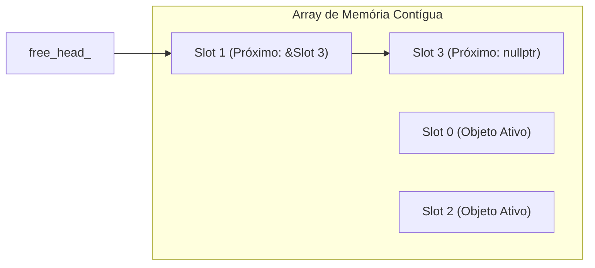

# Memory Pool vs Alocação Dinâmica

## Sumário

- [Introdução](#introdução)
- [O Custo Oculto de `new` e `delete`](#o-custo-oculto-de-new-e-delete)
- [Pool de Objetos com Free-List](#pool-de-objetos-com-free-list)
- [Alocador Linear Arena (Bump)](#alocador-linear-arena-bump)
- [Comparação Arquitetural](#comparação-arquitetural)
- [Boas Práticas em Loops de Jogos](#boas-práticas-em-loops-de-jogos)
- [Resumo](#resumo)

---

## Introdução

No desenvolvimento de jogos em tempo real, elementos de alta frequência como projéteis, partículas e efeitos visuais são criados e destruídos a cada quadro. Alocar cada instância via `new` e `delete` introduz contenção de locks do alocador, fragmentação de heap e degradação do cache da CPU.

---

## O Custo Oculto de `new` e `delete`

Chamar `new` invoca o alocador geral do sistema operacional (como `malloc` da glibc):

1. **Contenção de Bloqueios**: A heap geral é thread-safe e exige aquisição de travas internas durante alocações concorrentes.
2. **Sobrecarga de Metadados**: Cada bloco alocado armazena metadados (8 a 16 bytes adicionais por alocação) para rastreamento de tamanho.
3. **Falhas de Cache**: Instâncias alocadas ao longo do tempo ficam espalhadas na memória virtual, impedindo o prefetching eficiente das linhas de cache da CPU.

---

## Pool de Objetos com Free-List

Um pool com free-list pré-aloca um bloco contíguo de memória para uma capacidade máxima fixa. Os slots desocupados são encadeados usando um ponteiro intrusivo reaproveitando o próprio espaço do slot ocioso:



### Alocação: O(1)
Remove o primeiro slot disponível de `free_head_` e constrói o objeto no local usando placement new:
```cpp
Slot* slot = free_head_;
free_head_ = slot->next;
return ::new (slot->storage) T(args...);
```

### Desalocação: O(1)
Executa o destrutor e insere o slot de volta no topo da lista livre:
```cpp
ptr->~T();
auto* slot = reinterpret_cast<Slot*>(ptr);
slot->next = free_head_;
free_head_ = slot;
```

---

## Alocador Linear Arena (Bump)

O alocador linear de arena reserva um buffer de bytes contíguo e apenas incrementa um índice de offset quando a memória é solicitada. Desalocações individuais não existem; todo o buffer é reiniciado em O(1) zerando o offset ao término do quadro ou da fase.

- **Alocação**: Retorna ponteiro alinhado em `buffer + offset`, somando o tamanho ao `offset`.
- **Reset**: Define `offset = 0` instantaneamente.

Perfeito para memória temporária descartada em bloco a cada quadro.

---

## Comparação Arquitetural

| Métrica | `new` / `delete` | Free-List Pool | Alocador Arena |
|---|---|---|---|
| Tempo de Alocação | Variável (busca na heap) | O(1) garantido | O(1) incremento |
| Tempo de Desalocação | Variável (fusão de blocos) | O(1) inserção na lista | O(0) / reset O(1) |
| Chamadas à Heap em Execução | 1 por objeto | **0** | **0** |
| Sobrecarga de Memória | 16 B por bloco | 0 B (intrusivo) | 0 B |
| Localidade de Memória | Fragmentada | Alta (array contíguo) | Máxima (buffer denso) |

---

## Boas Práticas em Loops de Jogos

1. **Pré-aloque no carregamento**: Crie os pools e arenas antes de iniciar a simulação para eliminar pausas durante o gameplay.
2. **Use free-lists para tempo de vida arbitrário**: Quando entidades nascem e morrem fora de ordem, use o pool com free-list.
3. **Use arenas para ciclos em lote**: Quando entidades compartilham o mesmo tempo de vida (ex.: final do quadro ou término da onda), use alocadores lineares.
