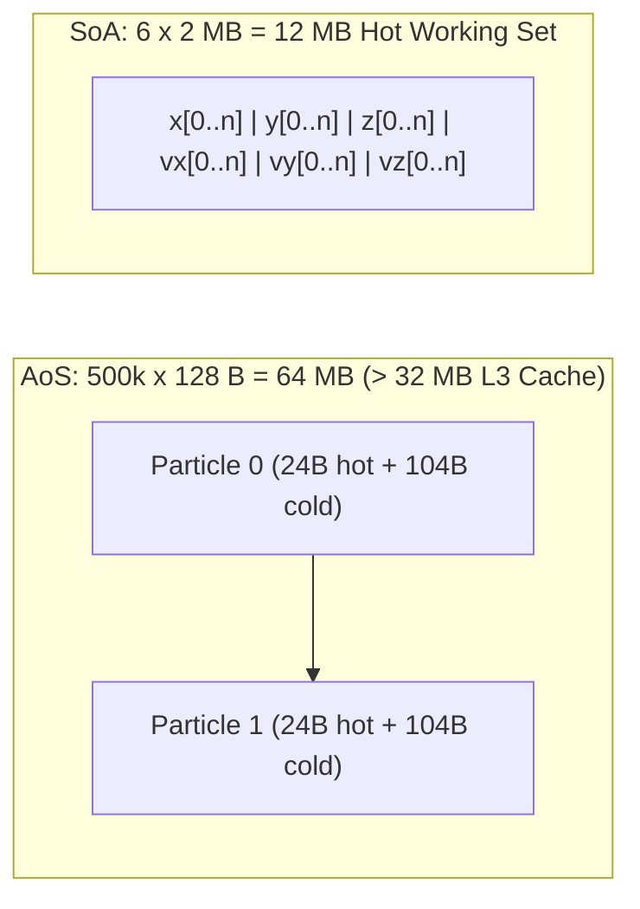

# SoA vs AoS (Particle Physics & Frustum Culling)

## Table of Contents

- [Intuition: The Grocery Shopping List](#intuition-the-grocery-shopping-list)
- [Hardware and Memory Layout](#hardware-and-memory-layout)
- [Step-by-Step Code Walkthrough](#step-by-step-code-walkthrough)
- [Trade-offs and Pitfalls](#trade-offs-and-pitfalls)
- [How to Verify and Profile](#how-to-verify-and-profile)
- [Summary](#summary)

---

## Intuition: The Grocery Shopping List

Suppose you run a bakery and need to add up the weight of 500,000 bags of flour.

- **Array of Structures (`AoS`)**: Every bag's label is a giant 128-page binder containing its weight, recipe history, store address, tax forms, and marketing photos. To read the weight on page 1, you have to carry the entire 128-page binder to your desk, read 24 lines, and throw the other 104 pages aside.
- **Structure of Arrays (`SoA`)**: You put all 500,000 weights on one slim spreadsheet, all prices on another, and all recipes in a third binder in the back room. When you only need weights, your desk holds 16 weights per sheet with zero wasted paper.

Your CPU cache works the same way: every time it reads a 64-byte cache line from RAM, any cold fields sitting inside that line steal precious memory bandwidth.

---

## Hardware and Memory Layout

In `particle_layouts.hpp`, `AosParticle` is `128` bytes (`static_assert(sizeof(AosParticle) == 128)`), spanning **two** 64-byte cache lines. During physics integration and culling, only the first `24` bytes (`x, y, z, vx, vy, vz`) are hot (`18.75%` cache-line utilization):

```text
AoS (128 bytes = 2 cache lines per particle; 81.25% wasted during physics)
Cache Line 0 [0..63]:   | x | y | z | vx | vy | vz | life | r | g | b | a | cold_matrix[0..4]  |
                          |<----- 24B HOT ----->|   |<------------- 40B COLD ---------------->|
Cache Line 1 [64..127]: | cold_matrix[5..15] (44B)              | flags (4B) | pad[4] (16B)    |
                          |<---------------------------- 64B COLD --------------------------->|

SoA (64-byte cache line in x_[]; 100% hot data, SIMD-ready)
Cache Line [0..63]:     | x[0] | x[1] | x[2] | x[3] | ... | x[15] |  --> 16 floats per line!
```



Across `500,000` particles, `AoS` touches `64 MB`—exceeding a `32 MB` L3 cache and hitting DRAM on every frame—whereas `SoA` streams only `12 MB` of hot floats.

---

## Step-by-Step Code Walkthrough

In [`lessons/SoaVsAos/include/particle_layouts.hpp`](../include/particle_layouts.hpp), both layouts implement `integrate_and_cull(float dt, float max_bound, int frames)`.

### 1. Naive Approach: `AosParticles`

`AosParticles` holds `std::vector<AosParticle> particles_`. The update loop looks clean, but every iteration pulls `128` bytes per particle across the memory bus:

```cpp
for (auto& p : particles_) {
    p.x += p.vx * dt;
    p.y += p.vy * dt;
    p.z += p.vz * dt;
}
```

And the subsequent culling pass only reads `x, y, z` (`12` bytes out of `128`), wasting `90.6%` of each pair of cache lines.

### 2. Optimized Approach: `SoaParticles`

`SoaParticles` stores each field in its own `std::vector<float>` (`x_, y_, z_, vx_, vy_, vz_` for physics; `life_, r_, g_, b_, a_, flags_` for rendering). Inside `integrate_and_cull`, it extracts `__restrict` pointers:

```cpp
float* __restrict px = x_.data();
float* __restrict py = y_.data();
float* __restrict pz = z_.data();
const float* __restrict pvx = vx_.data();
const float* __restrict pvy = vy_.data();
const float* __restrict pvz = vz_.data();

for (std::size_t i = 0; i < n; ++i) {
    px[i] += pvx[i] * dt;
    py[i] += pvy[i] * dt;
    pz[i] += pvz[i] * dt;
}
```

Because `__restrict` promises the compiler that `px`, `py`, `pz`, `pvx`, `pvy`, and `pvz` do not overlap, GCC/Clang can emit packed SIMD instructions (SSE/AVX) operating on 4 or 8 floats per cycle.

---

## Trade-offs and Pitfalls

### When NOT to Use SoA

- **Random per-entity access**: If you look up one random entity by ID and read all 12 of its fields at once, AoS fetches it in 1–2 cache lines, while SoA scatters across 12 separate arrays (12 cache misses).
- **Small working sets or low entity counts**: If `N * sizeof(T)` fits comfortably in L1/L2 cache (e.g., 100 UI widgets), AoS is simpler to maintain and already fast.
- **Frequent insertions/removals**: Swap-and-pop on an SoA container must swap across *every* channel array in lockstep, which adds boilerplate unless wrapped in an `SoaContainer` helper.
- **Hybrid alternative (AoSoA)**: Grouping 4 or 8 entities per SIMD-width struct (`struct Block8 { float x[8], y[8], z[8]; }`) gives SIMD density with better locality for per-entity access.

---

## How to Verify and Profile

Build and run the benchmark, then check cache misses and inspect generated SIMD assembly on Compiler Explorer or with `objdump`:

```bash
cmake -S . -B build -DCMAKE_BUILD_TYPE=Release
cmake --build build --target soa_vs_aos_bench
./build/lessons/SoaVsAos/soa_vs_aos_bench
perf stat -e cache-misses,LLC-load-misses,L1-dcache-load-misses ./build/lessons/SoaVsAos/soa_vs_aos_bench
```

To verify SIMD vectorization, compile with `-O2 -Rpass=loop-vectorize` (Clang) or `-O2 -fopt-info-vec-optimized` (GCC).

---

## Summary

Workload: `500,000` particles integrated and culled over `60` frames (`dt = 0.016f`, `g++ 13.3.0 -O2`, Ryzen 7 5800X):

| Metric | `AosParticles` (`128 B` struct) | `SoaParticles` (parallel `float` channels) |
|---|---:|---:|
| Total Time (`60` frames) | `228.953 ms` | `31.530 ms` (`7.26x` faster) |
| Cache-line utilization (physics) | `18.75%` (`24 B` / `128 B`) | `100%` (`16` floats per `64 B` line) |
| Hot working set (`500k` particles) | `64 MB` (> L3 cache) | `12 MB` (fits in L3 cache) |
| SIMD auto-vectorization | Blocked by strided layout | Enabled via contiguous arrays + `__restrict` |
| Single-entity random lookup | `1–2` cache lines | `N` cache lines (1 per channel) |
