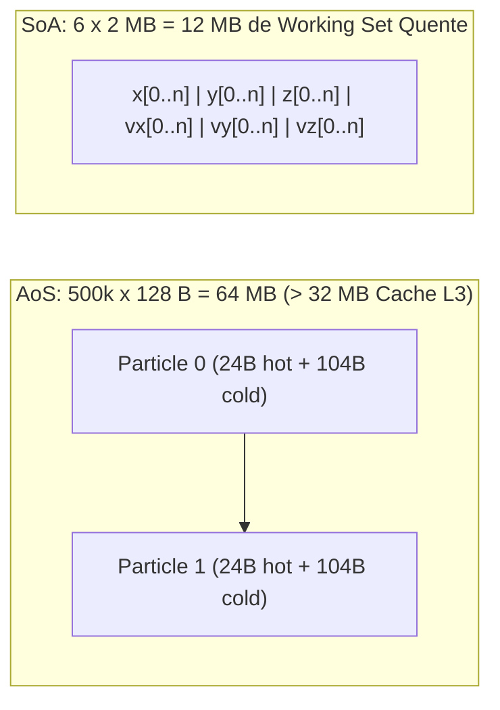

# SoA vs AoS (Física de Partículas e Culling)

## Índice

- [Intuição: O Fichário vs. A Planilha](#intuição-o-fichário-vs-a-planilha)
- [Hardware e Layout de Memória](#hardware-e-layout-de-memória)
- [Passo a Passo do Código](#passo-a-passo-do-código)
- [Trade-offs e Armadilhas](#trade-offs-e-armadilhas)
- [Como Verificar e Fazer Profiling](#como-verificar-e-fazer-profiling)
- [Resumo](#resumo)

---

## Intuição: O Fichário vs. A Planilha

Imagine que você gerencia uma padaria e precisa somar o peso de 500.000 sacos de farinha.

- **Array of Structures (`AoS`)**: A etiqueta de cada saco é um fichário de 128 páginas com peso, histórico de receitas, endereço da loja, notas fiscais e fotos. Para ler o peso na página 1, você precisa carregar o fichário inteiro de 128 páginas até a sua mesa, ler 24 linhas e ignorar as outras 104 páginas.
- **Structure of Arrays (`SoA`)**: Você coloca todos os 500.000 pesos em uma única planilha fina, todos os preços em outra e as receitas em um arquivo nos fundos. Quando você só precisa dos pesos, sua mesa comporta 16 pesos por folha sem nenhum papel desperdiçado.

O cache da CPU funciona igual: toda vez que ele busca uma cache line de 64 bytes da RAM, qualquer campo frio dentro dessa linha rouba banda de memória preciosa.

---

## Hardware e Layout de Memória

Em `particle_layouts.hpp`, `AosParticle` ocupa `128` bytes (`static_assert(sizeof(AosParticle) == 128)`), atravessando **duas** linhas de cache de 64 bytes. Durante a física e o culling, apenas os primeiros `24` bytes (`x, y, z, vx, vy, vz`) são quentes (`18,75%` de aproveitamento):

```text
AoS (128 bytes = 2 cache lines por partícula; 81,25% desperdiçado na física)
Cache Line 0 [0..63]:   | x | y | z | vx | vy | vz | life | r | g | b | a | cold_matrix[0..4]  |
                          |<----- 24B HOT ----->|   |<------------- 40B COLD ---------------->|
Cache Line 1 [64..127]: | cold_matrix[5..15] (44B)              | flags (4B) | pad[4] (16B)    |
                          |<---------------------------- 64B COLD --------------------------->|

SoA (cache line de 64 bytes em x_[]; 100% dados quentes, pronto para SIMD)
Cache Line [0..63]:     | x[0] | x[1] | x[2] | x[3] | ... | x[15] |  --> 16 floats por linha!
```



Com `500.000` partículas, o `AoS` toca `64 MB`—estourando um cache L3 de `32 MB` e indo à DRAM todo frame—enquanto o `SoA` lê apenas `12 MB` de floats quentes.

---

## Passo a Passo do Código

Em [`lessons/SoaVsAos/include/particle_layouts.hpp`](../include/particle_layouts.hpp), ambos os layouts implementam `integrate_and_cull(float dt, float max_bound, int frames)`.

### 1. Abordagem Ingênua: `AosParticles`

`AosParticles` guarda `std::vector<AosParticle> particles_`. O loop parece simples, mas cada iteração puxa `128` bytes por partícula pelo barramento de memória:

```cpp
for (auto& p : particles_) {
    p.x += p.vx * dt;
    p.y += p.vy * dt;
    p.z += p.vz * dt;
}
```

Na etapa seguinte de culling, apenas `x, y, z` (`12` de `128` bytes) são lidos, desperdiçando `90,6%` de cada par de cache lines.

### 2. Abordagem Otimizada: `SoaParticles`

`SoaParticles` separa cada canal em seu próprio `std::vector<float>` (`x_, y_, z_, vx_, vy_, vz_` para física; `life_, r_, g_, b_, a_, flags_` para renderização). Em `integrate_and_cull`, ele extrai ponteiros com `__restrict`:

```cpp
float* __restrict px = x_.data();
float* __restrict py = y_.data();
float* __restrict pz = z_.data();
const float* __restrict pvx = vx_.data();
const float* __restrict pvy = vy_.data();
const float* __restrict pvz = vz_.data();

for (std::size_t i = 0; i < n; ++i) {
    px[i] += pvx[i] * dt;
    py[i] += pvy[i] * dt;
    pz[i] += pvz[i] * dt;
}
```

Como `__restrict` garante ao compilador que `px`, `py`, `pz`, `pvx`, `pvy` e `pvz` não se sobrepõem, GCC e Clang geram instruções SIMD (SSE/AVX) processando 4 ou 8 floats por ciclo.

---

## Trade-offs e Armadilhas

### Quando NÃO Usar SoA

- **Acesso aleatório por entidade**: Se você busca uma única entidade por ID e lê todos os 12 campos dela de uma vez, AoS busca em 1–2 cache lines, enquanto SoA espalha o acesso por 12 vetores diferentes (12 cache misses).
- **Conjuntos pequenos**: Se `N * sizeof(T)` cabe com folga no cache L1/L2 (ex.: 100 elementos de UI), AoS é mais simples de manter e já é rápido.
- **Inserções e remoções frequentes**: Swap-and-pop em SoA precisa trocar elementos em *todos* os vetores em sincronia, exigindo um wrapper como um `SoaContainer`.
- **Alternativa híbrida (AoSoA)**: Agrupar 4 ou 8 entidades por struct do tamanho do registrador SIMD (`struct Block8 { float x[8], y[8], z[8]; }`) combina densidade SIMD com boa localidade por entidade.

---

## Como Verificar e Fazer Profiling

Compile e execute o benchmark e verifique cache misses e vetorização SIMD:

```bash
cmake -S . -B build -DCMAKE_BUILD_TYPE=Release
cmake --build build --target soa_vs_aos_bench
./build/lessons/SoaVsAos/soa_vs_aos_bench
perf stat -e cache-misses,LLC-load-misses,L1-dcache-load-misses ./build/lessons/SoaVsAos/soa_vs_aos_bench
```

Para confirmar a auto-vetorização SIMD, compile com `-O2 -Rpass=loop-vectorize` (Clang) ou `-O2 -fopt-info-vec-optimized` (GCC).

---

## Resumo

Carga: `500.000` partículas integradas e filtradas por `60` frames (`dt = 0.016f`, `g++ 13.3.0 -O2`, Ryzen 7 5800X):

| Métrica | `AosParticles` (struct de `128 B`) | `SoaParticles` (canais `float` paralelos) |
|---|---:|---:|
| Tempo total (`60` frames) | `228.953 ms` | `31.530 ms` (`7.26x` mais rápido) |
| Uso útil da cache line (física) | `18,75%` (`24 B` / `128 B`) | `100%` (`16` floats por linha de `64 B`) |
| Working set quente (`500k` itens) | `64 MB` (> cache L3) | `12 MB` (cabe no cache L3) |
| Auto-vetorização SIMD | Bloqueada pelo stride | Habilitada por arrays contíguos + `__restrict` |
| Busca aleatória de 1 entidade | `1–2` cache lines | `N` cache lines (1 por canal) |
