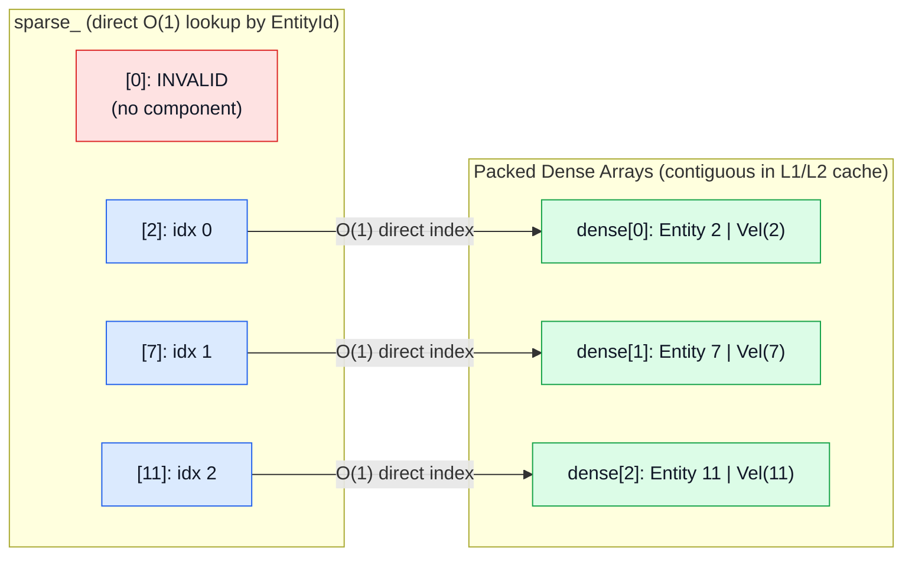

# ECS Sparse Set vs. `std::unordered_map` in C++20

## Table of Contents

- [Introduction](#introduction)
- [What Actually Happens Under the Hood?](#what-actually-happens-under-the-hood)
- [Step-by-Step Code Walkthrough](#step-by-step-code-walkthrough)
  - [1. `std::unordered_map` (Node-Based Baseline)](#1-stdunordered_map-node-based-baseline)
  - [2. `FlatOpenMapStorage` (Open-Addressing Hash Table)](#2-flatopenmapstorage-open-addressing-hash-table)
  - [3. `SparseSet<T>` (Dense ECS Storage)](#3-sparsesett-dense-ecs-storage)
- [Benchmark Results](#benchmark-results)
- [Common Pitfalls & When NOT to Use This](#common-pitfalls--when-not-to-use-this)
- [How to Diagnose Component Storage Bottlenecks](#how-to-diagnose-component-storage-bottlenecks)
- [Summary Comparison](#summary-comparison)

---

## Introduction

In an Entity Component System (ECS), entities are integer handles (`EntityId`), and components (`Velocity`, `Transform`, `Health`) are optional payloads attached to a subset of entities. A common first instinct is reaching for `std::unordered_map<EntityId, Velocity>`.

While `std::unordered_map` offers $O(1)$ average lookup, it allocates a separate heap node for every component, hashes integer IDs on every lookup, and scatters components across memory. A **Sparse Set** (`SparseSet<T>`) solves all three problems simultaneously.

---

## What Actually Happens Under the Hood?

A `SparseSet<T>` maintains three arrays:
1. `sparse_`: indexed directly by `EntityId`, storing the element's index inside the dense arrays (or `kInvalidIndex`).
2. `dense_entities_`: packed list of active `EntityId`s (`dense_entities_[sparse_[id]] == id`).
3. `dense_data_`: packed, contiguous `T` components aligned 1-to-1 with `dense_entities_`.



When an entity is removed, `SparseSet<T>::remove(id)` performs an $O(1)$ **swap-and-pop**: it moves the last element of `dense_data_` and `dense_entities_` into the removed slot, updates `sparse_[moved_entity]`, and pops the back.

---

## Step-by-Step Code Walkthrough

### 1. `std::unordered_map` (Node-Based Baseline)

In [sparse_set.hpp](../include/sparse_set.hpp), `UnorderedMapStorage<T>` wraps `std::unordered_map<EntityId, T>`. Every `insert` allocates a heap node, and `remove` must unlink and `delete` it.

### 2. `FlatOpenMapStorage` (Open-Addressing Hash Table)

`FlatOpenMapStorage<T>` places all slots in a single contiguous `std::vector<Slot>` using linear probing and **tombstones** (special "deleted" markers left in vacated slots so subsequent hash searches don't stop early). This removes per-node heap allocations (`0.813 ms` erase vs `15.390 ms`), **but** iterating over active elements must still skip empty and tombstone slots across the entire power-of-two capacity (`111.301 ms`!).

### 3. `SparseSet<T>` (Dense ECS Storage)

`SparseSet<T>` gives direct $O(1)$ unhashed indexing and dense iteration via `std::span<T>`:

```cpp
const uint32_t removed_dense_idx = sparse_[id];
const uint32_t last_dense_idx = static_cast<uint32_t>(dense_entities_.size() - 1);

if (removed_dense_idx != last_dense_idx) {
    const EntityId moved_entity = dense_entities_[last_dense_idx];
    dense_entities_[removed_dense_idx] = moved_entity;
    dense_data_[removed_dense_idx] = std::move(dense_data_[last_dense_idx]);
    sparse_[moved_entity] = removed_dense_idx;
}

dense_entities_.pop_back();
dense_data_.pop_back();
sparse_[id] = kInvalidIndex;
```

---

## Benchmark Results

Measured with `./build/SparseSet_benchmark` (`g++ 13.3.0 -std=c++20 -O2`) for 100,000 entities, 100 iteration frames, and 50,000 erasures:

| Container | Insert (ms) | Lookup (ms) | Iterate 100x (ms) | Erase (ms) | Total (ms) | Speedup |
|---|---:|---:|---:|---:|---:|---:|
| `std::unordered_map` | 8.297 | 5.835 | 17.334 | 15.390 | 46.857 | 1.00x |
| `FlatOpenMap` | 5.437 | 4.310 | 111.301 | 0.813 | 121.861 | 0.38x |
| `SparseSet<T>` | **0.463** | **1.051** | **12.269** | **0.777** | **14.559** | **3.22x** |

---

## Common Pitfalls & When NOT to Use This

- **Do NOT use a flat `sparse_` vector for arbitrary 64-bit UUIDs:** `sparse_` grows to `max_entity_id + 1`. Use dense integer IDs with a free-list + generation counter, or switch to a **paged sparse array** (4 KB pages allocated on demand) when IDs are very sparse.
- **Swap-and-pop breaks insertion order:** Iterating over `dense_data()` visits entities in swapped order after removals. Never rely on stable iteration order.
- **Keep components small or split hot/cold data:** Massive component structs reduce how many elements fit per 64-byte cache line during dense iteration.

---

## How to Diagnose Component Storage Bottlenecks

1. **Profile allocator traffic (`heaptrack` / ASan):** Look for `std::_Hashtable::_M_allocate_node` in hot gameplay systems.
2. **Check `perf stat -e cache-misses,dTLB-load-misses`:** Non-contiguous node iteration causes significantly more LLC and TLB misses than `SparseSet<T>::dense_data()`.

---

## Summary Comparison

| Criterion | `std::unordered_map` | `FlatOpenMapStorage` | `SparseSet<T>` |
|---|---|---|---|
| Lookup | $O(1)$ hashed + pointer chase | $O(1)$ hashed + probe | **$O(1)$ direct array index** |
| Iteration | Scattered heap nodes | Scans empty/tombstone slots | **Tightly packed `std::span<T>`** |
| Erasure | Heap node `delete` | Tombstone flag | **$O(1)$ swap-and-pop** |
| Memory footprint | High (node pointers + buckets) | Moderate (load factor <= 0.7) | Dense data + `4 B * max_id` sparse |
