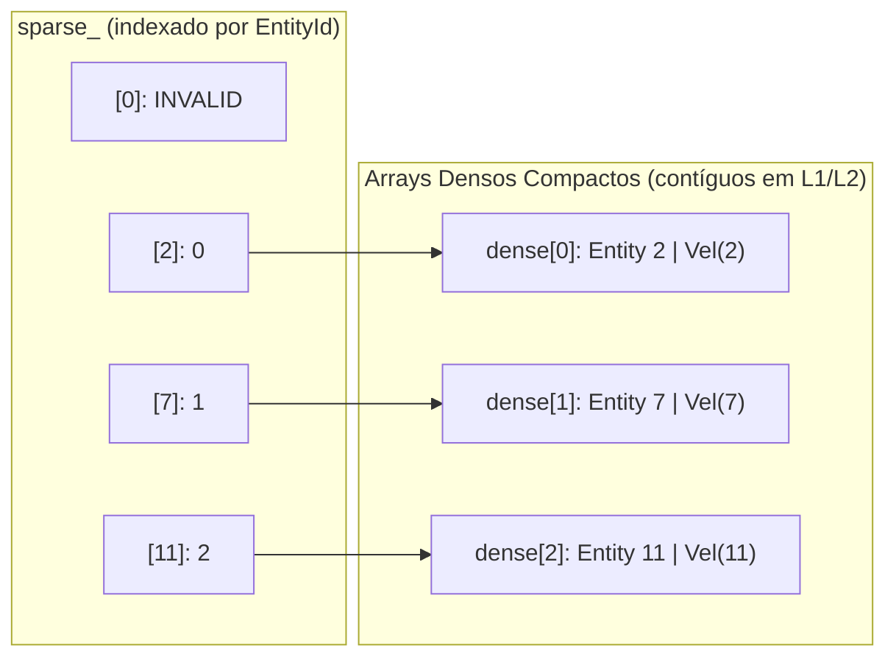

# Sparse Set para ECS vs. `std::unordered_map` em C++20

## Índice

- [Introdução](#introdução)
- [O Que Realmente Acontece por Baixo dos Panos?](#o-que-realmente-acontece-por-baixo-dos-panos)
- [Passo a Passo do Código](#passo-a-passo-do-código)
  - [1. `std::unordered_map` (Baseline Baseado em Nós)](#1-stdunordered_map-baseline-baseado-em-nós)
  - [2. `FlatOpenMapStorage` (Hash Table de Endereçamento Aberto)](#2-flatopenmapstorage-hash-table-de-endereçamento-aberto)
  - [3. `SparseSet<T>` (Armazenamento Denso de ECS)](#3-sparsesett-armazenamento-denso-de-ecs)
- [Resultados do Benchmark](#resultados-do-benchmark)
- [Armadilhas Comuns e Quando NÃO Usar](#armadilhas-comuns-e-quando-não-usar)
- [Como Diagnosticar Gargalos de Armazenamento de Componentes](#como-diagnosticar-gargalos-de-armazenamento-de-componentes)
- [Tabela Resumo Comparativa](#tabela-resumo-comparativa)

---

## Introdução

Em um Entity Component System (ECS), entidades são identificadores inteiros (`EntityId`) e componentes (`Velocity`, `Transform`, `Health`) são dados opcionais ligados a um subconjunto dessas entidades. O instinto inicial costuma ser usar `std::unordered_map<EntityId, Velocity>`.

Embora `std::unordered_map` tenha busca média $O(1)$, ele aloca um nó no heap por componente, calcula hash em toda consulta e espalha os dados pela memória. Um **Sparse Set** (`SparseSet<T>`) resolve esses três problemas de uma só vez.

---

## O Que Realmente Acontece por Baixo dos Panos?

Um `SparseSet<T>` mantém três arrays:
1. `sparse_`: indexado diretamente por `EntityId`, guardando o índice nos arrays densos (ou `kInvalidIndex`).
2. `dense_entities_`: lista compacta dos `EntityId` ativos (`dense_entities_[sparse_[id]] == id`).
3. `dense_data_`: componentes `T` contíguos e alinhados 1-para-1 com `dense_entities_`.



Ao remover uma entidade, `SparseSet<T>::remove(id)` executa um **swap-and-pop** em $O(1)$: move o último elemento de `dense_data_` e `dense_entities_` para a posição removida, atualiza `sparse_[moved_entity]` e faz `pop_back()`.

---

## Passo a Passo do Código

### 1. `std::unordered_map` (Baseline Baseado em Nós)

Em [sparse_set.hpp](../include/sparse_set.hpp), `UnorderedMapStorage<T>` encapsula `std::unordered_map<EntityId, T>`. Cada `insert` aloca um nó no heap e cada `remove` precisa desalocá-lo.

### 2. `FlatOpenMapStorage` (Hash Table de Endereçamento Aberto)

`FlatOpenMapStorage<T>` coloca todos os slots em um único `std::vector<Slot>` com linear probing e tombstones. Isso elimina alocações por nó (`0.813 ms` na remoção contra `15.390 ms`), **mas** iterar sobre os elementos ativos exige varrer slots vazios e tombstones por toda a tabela (`111.301 ms`!).

### 3. `SparseSet<T>` (Armazenamento Denso de ECS)

`SparseSet<T>` oferece indexação direta sem hash em $O(1)$ e iteração densa via `std::span<T>`:

```cpp
const uint32_t removed_dense_idx = sparse_[id];
const uint32_t last_dense_idx = static_cast<uint32_t>(dense_entities_.size() - 1);

if (removed_dense_idx != last_dense_idx) {
    const EntityId moved_entity = dense_entities_[last_dense_idx];
    dense_entities_[removed_dense_idx] = moved_entity;
    dense_data_[removed_dense_idx] = std::move(dense_data_[last_dense_idx]);
    sparse_[moved_entity] = removed_dense_idx;
}

dense_entities_.pop_back();
dense_data_.pop_back();
sparse_[id] = kInvalidIndex;
```

---

## Resultados do Benchmark

Medido com `./build/SparseSet_benchmark` (`g++ 13.3.0 -std=c++20 -O2`) com 100.000 entidades, 100 frames de iteração e 50.000 remoções:

| Container | Insert (ms) | Lookup (ms) | Iterate 100x (ms) | Erase (ms) | Total (ms) | Speedup |
|---|---:|---:|---:|---:|---:|---:|
| `std::unordered_map` | 8.297 | 5.835 | 17.334 | 15.390 | 46.857 | 1.00x |
| `FlatOpenMap` | 5.437 | 4.310 | 111.301 | 0.813 | 121.861 | 0.38x |
| `SparseSet<T>` | **0.463** | **1.051** | **12.269** | **0.777** | **14.559** | **3.22x** |

---

## Armadilhas Comuns e Quando NÃO Usar

- **NÃO use `sparse_` plano para UUIDs arbitrários de 64 bits:** O vetor `sparse_` cresce até `max_entity_id + 1`. Use IDs inteiros reciclados por free-list com geração ou adote um **sparse array paginado** (páginas de 4 KB sob demanda).
- **Swap-and-pop altera a ordem de iteração:** Após remoções, `dense_data()` não preserva a ordem de inserção. Nunca dependa da ordem para lógica determinística sem ordenação explícita.
- **Mantenha componentes enxutos:** Structs muito grandes reduzem a quantidade de elementos por cache line de 64 bytes durante a iteração densa.

---

## Como Diagnosticar Gargalos de Armazenamento de Componentes

1. **Profile de alocador (`heaptrack` / ASan):** Procure `std::_Hashtable::_M_allocate_node` em sistemas de simulação.
2. **Use `perf stat -e cache-misses,dTLB-load-misses`:** Iterar nós espalhados gera muito mais faltas de cache e TLB do que percorrer `SparseSet<T>::dense_data()`.

---

## Tabela Resumo Comparativa

| Critério | `std::unordered_map` | `FlatOpenMapStorage` | `SparseSet<T>` |
|---|---|---|---|
| Busca (`get`) | $O(1)$ com hash + pointer chasing | $O(1)$ com hash + probing | **$O(1)$ direto por índice** |
| Iteração | Nós espalhados no heap | Varre slots vazios/tombstones | **`std::span<T>` contíguo** |
| Remoção | `delete` de nó no heap | Marcação de tombstone | **$O(1)$ swap-and-pop** |
| Uso de memória | Alto (ponteiros + buckets) | Moderado (load factor <= 0.7) | Dados densos + `4 B * max_id` esparso |
