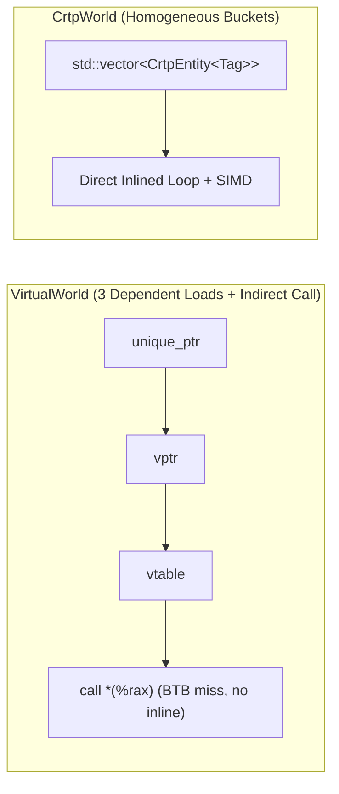

# Static Dispatch (Virtual vs CRTP vs Function Tables)

## Table of Contents

- [Intuition: The Mystery Package Sorting Line](#intuition-the-mystery-package-sorting-line)
- [Hardware and Memory Layout](#hardware-and-memory-layout)
- [Step-by-Step Code Walkthrough](#step-by-step-code-walkthrough)
- [Trade-offs and Pitfalls](#trade-offs-and-pitfalls)
- [How to Verify and Profile](#how-to-verify-and-profile)
- [Summary](#summary)

---

## Intuition: The Mystery Package Sorting Line

Imagine 50,000 workers on an assembly line, each needing one of 8 different instructions (`apply_behavior<0..7>`):

1. **`VirtualWorld` (`virtual` dispatch)**: Every worker stands in a different building. You walk to a worker, ask which manual they follow (`vptr`), walk to the library to open that manual (`vtable`), and read one line (`call *(%rax)`). You cannot prepare the next step in advance because every worker is a surprise.
2. **`TagSwitchWorld` / `FnTableWorld` (contiguous but shuffled)**: All 50,000 workers now stand in one hallway (`std::vector<PodEntity>`), but the 8 job types are randomly mixed. The CPU's **Branch Target Buffer (BTB)** guesses wrong almost every time.
3. **`CrtpWorld` (homogeneous buckets)**: You group all Type-0 workers together, then all Type-1 workers, and so on. Now you shout one instruction for 6,250 workers in a row—no manuals, no guessing, full speed.

---

## Hardware and Memory Layout

Calling a `virtual` function forces a chain of dependent pointer loads before the CPU even knows which instruction address to jump to:

```text
VirtualEntity<Tag> (heap-allocated, 24 bytes: 8B vptr + 16B floats)
[ vptr | x | y | vx | vy ]
   |
   +--> vtable_for_VirtualEntity<Tag> (read-only memory)
           |
           +--> &VirtualEntity<Tag>::update(float)  --> indirect `call *(%rax)`
                                                        (BTB mispredict + blocks inlining!)

CrtpEntity<Tag> in homogeneous std::vector<CrtpEntity<Tag>> (16 bytes, 4 per cache line)
|<------------------ 64-byte Cache Line ------------------>|
| CrtpEntity<0>[0] | CrtpEntity<0>[1] | CrtpEntity<0>[2] | CrtpEntity<0>[3] |
```



Because an indirect `call *(%rax)` hides the target function at compile time, it forms an optimization barrier that blocks **inlining** and loop auto-vectorization.

---

## Step-by-Step Code Walkthrough

In [`lessons/StaticDispatch/include/dispatch_common.hpp`](../include/dispatch_common.hpp) and [`lessons/StaticDispatch/include/dispatch_models.hpp`](../include/dispatch_models.hpp), four worlds run the same 8 behaviors (`apply_behavior<0..7>`).

### 1. Naive Approach: `VirtualWorld`

`VirtualWorld` stores `std::vector<std::unique_ptr<IEntity>>` and shuffles the pointers. `e->update(dt)` suffers heap pointer chasing, vtable indirection, and BTB mispredictions.

### 2. Contiguous Heterogeneous Approaches: `FnTableWorld` & `TagSwitchWorld`

Both pack `PodEntity` (`17` bytes + padding = `20` bytes) contiguously in `std::vector<PodEntity>`, eliminating heap indirection. However, because `entities_` is shuffled across 8 tags, `switch (e.tag)` and `table[e.tag & 7u](e, dt)` still mispredict on nearly every entity, recovering only `1.19x`–`1.30x`.

### 3. Optimized Approach: `CrtpWorld`

`CrtpBase<Derived>` resolves the derived type at compile time via `static_cast<Derived*>(this)->update_impl(dt)` with zero `vptr`. `CrtpWorld` stores 8 homogeneous vectors inside a `std::tuple`:

```cpp
template <typename Vec>
static void update_bucket(Vec& v, float dt) noexcept {
    for (auto& e : v) e.update(dt);
}

void update_all(float dt, int frames) noexcept {
    for (int f = 0; f < frames; ++f) {
        std::apply([dt](auto&... vecs) { (update_bucket(vecs, dt), ...); }, buckets_);
    }
}
```

Each bucket runs a tight, predictable loop where `apply_behavior<Tag>` is completely inlined.

---

## Trade-offs and Pitfalls

### When NOT to Use CRTP Buckets

- **Open-ended runtime plugins or modding**: If concrete types are loaded dynamically from `.so`/`.dll` plugins at runtime, the set of types is not closed at compile time—use `virtual` interfaces at the subsystem boundary.
- **Per-frame cross-type ordering**: If entities must be updated in strict interleaved global order (e.g., sorted by Z-depth), splitting them into per-type buckets breaks that order.
- **Code bloat**: Instantiating many heavy `CrtpEntity<Tag>` templates increases binary size and compile times if `update_impl` is large. Keep CRTP for hot, small, closed sets of types (or use `std::variant` when heterogeneous order must stay in one vector).

---

## How to Verify and Profile

Build and run the benchmark, then measure branch mispredictions with `perf stat`:

```bash
cmake -S . -B build -DCMAKE_BUILD_TYPE=Release
cmake --build build --target static_dispatch_bench
./build/lessons/StaticDispatch/static_dispatch_bench
perf stat -e branches,branch-misses,cycles,instructions ./build/lessons/StaticDispatch/static_dispatch_bench
```

You can also inspect `VirtualWorld::update_all` vs `CrtpWorld::update_all` in Compiler Explorer (`godbolt.org`, `-O2 -std=c++20`) to see `call *(%rax)` disappear and inline vector math appear.

---

## Summary

Workload: `50,000` entities across `8` behavior types updated over `60` frames (`dt = 0.016f`, `g++ 13.3.0 -O2`, Ryzen 7 5800X):

| Strategy | Total Time (`60` frames) | Speedup vs Virtual | Vtable / Inlining |
|---|---:|---:|---|
| `VirtualWorld` (`unique_ptr<IEntity>`) | `37.782 ms` | `1.00x` | Vtable `call *(%rax)`, no inlining |
| `TagSwitchWorld` (`PodEntity` + `switch`) | `31.641 ms` | `1.19x` faster | No vtable, shuffled BTB misses |
| `FnTableWorld` (`PodEntity` + fn table) | `29.142 ms` | `1.30x` faster | Indirect call, shuffled BTB misses |
| `CrtpWorld` (`8` CRTP `std::vector` buckets) | `4.381 ms` | `8.62x` faster | **Fully inlined**, zero BTB misses |
