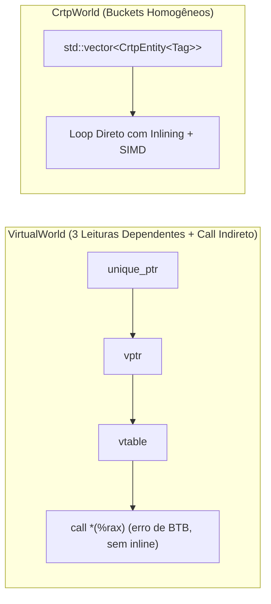

# Static Dispatch (Virtual vs CRTP vs Tabelas de Função)

## Índice

- [Intuição: A Linha de Montagem Sem Surpresas](#intuição-a-linha-de-montagem-sem-surpresas)
- [Hardware e Layout de Memória](#hardware-e-layout-de-memória)
- [Passo a Passo do Código](#passo-a-passo-do-código)
- [Trade-offs e Armadilhas](#trade-offs-e-armadilhas)
- [Como Verificar e Fazer Profiling](#como-verificar-e-fazer-profiling)
- [Resumo](#resumo)

---

## Intuição: A Linha de Montagem Sem Surpresas

Imagine 50.000 operadores em uma fábrica, cada um executando uma de 8 instruções diferentes (`apply_behavior<0..7>`):

1. **`VirtualWorld` (dispatch `virtual`)**: Cada operador está em um prédio diferente. Você vai até o operador, pergunta qual manual ele segue (`vptr`), vai até a estante abrir o manual (`vtable`) e lê a instrução (`call *(%rax)`). Não dá para prever o próximo passo porque cada operador é uma surpresa.
2. **`TagSwitchWorld` / `FnTableWorld` (contíguo, mas embaralhado)**: Todos os 50.000 operadores estão no mesmo corredor (`std::vector<PodEntity>`), mas os 8 tipos estão misturados. O **Branch Target Buffer (BTB)** da CPU erra a previsão quase toda vez.
3. **`CrtpWorld` (buckets homogêneos)**: Você agrupa todos os operadores do Tipo 0 juntos, depois os do Tipo 1, e assim por diante. Agora você dá uma única ordem para 6.250 operadores seguidos—sem manuais, sem adivinhação, na velocidade máxima.

---

## Hardware e Layout de Memória

Chamar uma função `virtual` exige uma cadeia de leituras dependentes antes mesmo de a CPU saber para qual endereço saltar:

```text
VirtualEntity<Tag> (alocado no heap, 24 bytes: 8B vptr + 16B floats)
[ vptr | x | y | vx | vy ]
   |
   +--> vtable_for_VirtualEntity<Tag> (memória somente leitura)
           |
           +--> &VirtualEntity<Tag>::update(float)  --> `call *(%rax)` indireto
                                                        (erro de BTB + bloqueia inlining!)

CrtpEntity<Tag> em std::vector<CrtpEntity<Tag>> homogêneo (16 bytes, 4 por cache line)
|<------------------ Cache Line de 64 bytes ------------------>|
| CrtpEntity<0>[0] | CrtpEntity<0>[1] | CrtpEntity<0>[2] | CrtpEntity<0>[3] |
```



Como um `call *(%rax)` indireto esconde a função de destino em tempo de compilação, ele cria uma barreira que impede o **inlining** e a auto-vetorização do loop.

---

## Passo a Passo do Código

Em [`lessons/StaticDispatch/include/dispatch_common.hpp`](../include/dispatch_common.hpp) e [`lessons/StaticDispatch/include/dispatch_models.hpp`](../include/dispatch_models.hpp), quatro classes executam os mesmos 8 comportamentos (`apply_behavior<0..7>`).

### 1. Abordagem Ingênua: `VirtualWorld`

`VirtualWorld` guarda `std::vector<std::unique_ptr<IEntity>>` com ponteiros embaralhados. `e->update(dt)` sofre com pointer chasing no heap, indireção de vtable e erros no BTB.

### 2. Abordagens Contíguas Heterogêneas: `FnTableWorld` e `TagSwitchWorld`

Ambas armazenam `PodEntity` (`20` bytes) de forma contígua em `std::vector<PodEntity>`, eliminando a indireção no heap. Porém, como `entities_` continua embaralhado entre 8 tags, `switch (e.tag)` e `table[e.tag & 7u](e, dt)` ainda erram a predição de desvio na maior parte das entidades, ganhando apenas `1.19x`–`1.30x`.

### 3. Abordagem Otimizada: `CrtpWorld`

`CrtpBase<Derived>` resolve o tipo derivado em tempo de compilação via `static_cast<Derived*>(this)->update_impl(dt)` sem nenhum `vptr`. `CrtpWorld` mantém 8 vetores homogêneos em um `std::tuple`:

```cpp
template <typename Vec>
static void update_bucket(Vec& v, float dt) noexcept {
    for (auto& e : v) e.update(dt);
}

void update_all(float dt, int frames) noexcept {
    for (int f = 0; f < frames; ++f) {
        std::apply([dt](auto&... vecs) { (update_bucket(vecs, dt), ...); }, buckets_);
    }
}
```

Cada bucket executa um loop previsível em que `apply_behavior<Tag>` recebe inlining completo.

---

## Trade-offs e Armadilhas

### Quando NÃO Usar Buckets com CRTP

- **Plugins dinâmicos em runtime**: Se novos tipos são carregados de `.so`/`.dll` em tempo de execução, o conjunto não é fechado na compilação—use interfaces `virtual` na fronteira do subsistema.
- **Ordem global estrita entre tipos por frame**: Se as entidades precisam atualizar em ordem intercalada fixa (ex.: ordenadas por profundidade Z), separá-las em buckets por tipo quebra essa ordem.
- **Inchaço de binário (code bloat)**: Instanciar muitos templates `CrtpEntity<Tag>` pesados aumenta o tamanho do executável e o tempo de compilação. Prefira CRTP em loops quentes com conjuntos fechados e pequenos (ou `std::variant` se precisar manter ordem heterogênea em um único vetor).

---

## Como Verificar e Fazer Profiling

Compile e execute o benchmark e meça erros de predição de desvio com `perf stat`:

```bash
cmake -S . -B build -DCMAKE_BUILD_TYPE=Release
cmake --build build --target static_dispatch_bench
./build/lessons/StaticDispatch/static_dispatch_bench
perf stat -e branches,branch-misses,cycles,instructions ./build/lessons/StaticDispatch/static_dispatch_bench
```

Você também pode comparar `VirtualWorld::update_all` e `CrtpWorld::update_all` no Compiler Explorer (`godbolt.org`, `-O2 -std=c++20`) para ver `call *(%rax)` sumir e dar lugar a instruções inline.

---

## Resumo

Carga: `50.000` entidades em `8` tipos de comportamento por `60` frames (`dt = 0.016f`, `g++ 13.3.0 -O2`, Ryzen 7 5800X):

| Estratégia | Tempo total (`60` frames) | Ganho vs Virtual | Vtable / Inlining |
|---|---:|---:|---|
| `VirtualWorld` (`unique_ptr<IEntity>`) | `37.782 ms` | `1.00x` | Vtable `call *(%rax)`, sem inlining |
| `TagSwitchWorld` (`PodEntity` + `switch`) | `31.641 ms` | `1.19x` mais rápido | Sem vtable, erros de BTB |
| `FnTableWorld` (`PodEntity` + fn table) | `29.142 ms` | `1.30x` mais rápido | Chamada indireta, erros de BTB |
| `CrtpWorld` (`8` buckets `std::vector` CRTP) | `4.381 ms` | `8.62x` mais rápido | **Inlining completo**, zero erros de BTB |
