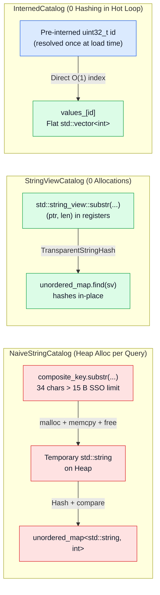

# String View, SSO, and String Interning

## Table of Contents

- [Intuition: Photocopying vs. Pointing vs. Locker Numbers](#intuition-photocopying-vs-pointing-vs-locker-numbers)
- [Hardware and Memory Layout](#hardware-and-memory-layout)
- [Step-by-Step Code Walkthrough](#step-by-step-code-walkthrough)
  - [1. Naive Approach: `NaiveStringCatalog` (`std::string::substr`)](#1-naive-approach-naivestringcatalog-stdstringsubstr)
  - [2. Zero-Allocation View: `StringViewCatalog` (`std::string_view` + Transparent Hash)](#2-zero-allocation-view-stringviewcatalog-stdstring_view--transparent-hash)
  - [3. Load-Time Resolution: `InternedCatalog` (Pre-Interned `uint32_t` IDs)](#3-load-time-resolution-internedcatalog-pre-interned-uint32_t-ids)
- [Trade-offs and Pitfalls](#trade-offs-and-pitfalls)
- [How to Verify and Profile](#how-to-verify-and-profile)
- [Summary](#summary)

---

## Intuition: Photocopying vs. Pointing vs. Locker Numbers

Imagine a game engine resolving 10,000 attribute keys every frame, formatted like `"combat_ns:entity_attribute_modifier_value_42"`. You only need the part after `:` to look up the value in a catalog. There are three ways to do this:

1. **Photocopying (`std::string::substr`)**: Every time you want to check the suffix, you buy a brand-new notebook (heap allocation), copy the 34 characters into it, hand it to the librarian (`std::unordered_map::find`), and immediately shred the notebook when the lookup finishes. Doing that 2,000,000 times wastes most of your time talking to the memory allocator.
2. **Pointing with your finger (`std::string_view`)**: You keep the original string untouched and simply point two fingers at it—*start here, read 34 characters*. No notebook is bought, no characters are copied, and a **transparent hash** lets the librarian read directly from your finger span.
3. **Locker numbers (`uint32_t` interning)**: Instead of reading long text labels 10,000 times per frame, you ask the librarian once during level loading: *"Which locker number is `entity_attribute_modifier_value_42`?"* They hand you `42`. During the frame loop, you walk straight to locker `values_[42]` with zero hashing and zero string comparisons.

---

## Hardware and Memory Layout

**Small String Optimization (SSO)** is a trick built into `std::string`: instead of always allocating on the heap, `std::string` reserves a tiny inline buffer inside the `std::string` object itself. On `libstdc++` (x86_64), that inline pocket holds **up to 15 characters**.

- Strings of `<= 15` bytes fit inside the stack object (zero heap allocations).
- Strings of `>= 16` bytes overflow SSO and force a `malloc`/`free` pair on the heap.

Our suffix `"entity_attribute_modifier_value_<id>"` is **33–34 bytes**—more than double the 15-byte SSO limit:

```text
std::string (32 bytes on libstdc++ x86_64):
  <= 15 chars (fits SSO): [ inline char[16] | size ]              --> No heap allocation!
  >= 16 chars (overflow): [ ptr -> Heap Buffer (malloc/free) | size | cap ]  --> Heap allocation!

std::string_view (16 bytes, non-owning):
  [ const char* ptr | size_t len ]  --> Fits in 2 CPU registers, 0 heap allocations!
```



---

## Step-by-Step Code Walkthrough

All three catalogs live in [`lessons/StringViewSso/include/string_lookup.hpp`](../include/string_lookup.hpp).

### 1. Naive Approach: `NaiveStringCatalog` (`std::string::substr`)

`NaiveStringCatalog::lookup` slices the suffix after `:` into a brand-new `std::string`:

```cpp
[[nodiscard]] int lookup(const std::string& composite_key) const {
    std::size_t colon = composite_key.find(':');
    if (colon == std::string::npos || colon + 1 >= composite_key.size()) {
        return -1;
    }
    std::string sub_key = composite_key.substr(colon + 1); // > 15 bytes: heap alloc!
    auto it = table_.find(sub_key);
    return it != table_.end() ? it->second : -1;
}
```

Across `10,000` queries over `200` frames (`2,000,000` lookups), `sub_key` triggers `2,000,000` heap allocations and deallocations (`86.858 ms`).

### 2. Zero-Allocation View: `StringViewCatalog` (`std::string_view` + Transparent Hash)

By default, `std::unordered_map<std::string, int>::find(sv)` will **not** accept a `std::string_view` without constructing a temporary `std::string`—defeating the whole optimization. To enable **heterogeneous lookup** (querying with a different key type without converting it), we define `TransparentStringHash` with `using is_transparent = void;` and pair it with `std::equal_to<>`:

```cpp
struct TransparentStringHash {
    using is_transparent = void;
    [[nodiscard]] std::size_t operator()(std::string_view sv) const noexcept {
        return std::hash<std::string_view>{}(sv);
    }
};

// Inside StringViewCatalog:
std::unordered_map<std::string, int, TransparentStringHash, std::equal_to<>> table_;
```

Now `StringViewCatalog::lookup` slices in $O(1)$ register arithmetic with **0 heap allocations** (`39.524 ms`, `2.20x` faster):

```cpp
std::string_view sub_key = composite_key.substr(colon + 1); // Adjusts (ptr, len) only
auto it = table_.find(sub_key); // Hashes sub_key directly, no temporary std::string
```

### 3. Load-Time Resolution: `InternedCatalog` (Pre-Interned `uint32_t` IDs)

Hashing a 34-byte string still touches every character on every frame. **String interning** moves that work out of the frame loop: at load time, `preintern_queries` converts each string into a dense `uint32_t` index via `intern_composite`. At runtime, `lookup_id` is a single bounds-checked array read:

```cpp
[[nodiscard]] int lookup_id(std::uint32_t id) const noexcept {
    return id < values_.size() ? values_[id] : -1;
}
```

Eliminating per-frame hashing and hash-bucket pointer chasing drops the runtime to `0.900 ms` (`96.47x` faster).

---

## Trade-offs and Pitfalls

### When NOT to Use `std::string_view` or Interning

- **Dangling `std::string_view` (lifetime bugs)**: `std::string_view` does *not* own the characters it points to. Never store a `std::string_view` pointing to a temporary `std::string` that is about to be destroyed, or into a `std::string` that might reallocate.
- **Passing `sv.data()` to C APIs**: A `std::string_view` slice (especially a prefix or middle slice) is **not guaranteed to be null-terminated** (`'\0'`). Never pass `sv.data()` to `printf("%s", ...)` or `fopen()`.
- **Unbounded dynamic strings for interning**: Interning works best for known, bounded key sets (asset paths, attribute names, tags) resolved at load time. If you intern arbitrary user-generated chat messages forever, the interning table will grow without bound.

---

## How to Verify and Profile

Build and run the benchmark, then verify zero hot-path allocations with `heaptrack` or `perf stat`:

```bash
cmake -S . -B build -DCMAKE_BUILD_TYPE=Release
cmake --build build --target string_view_sso_bench
./build/lessons/StringViewSso/string_view_sso_bench
perf stat -e cache-misses,instructions,branches ./build/lessons/StringViewSso/string_view_sso_bench
```

To catch accidental dangling `std::string_view` lifetimes during tests, compile with AddressSanitizer (`-fsanitize=address,undefined`).

---

## Summary

Workload: `10,000` composite attribute queries (`"combat_ns:entity_attribute_modifier_value_<id>"`) per frame across `200` frames (`2,000,000` total lookups, `g++ -std=c++20 -O2`):

| Approach | Total Time (`200` frames) | Speedup vs Baseline | Hot-Path Heap Allocations |
|---|---:|---:|---:|
| `NaiveStringCatalog` (`std::string::substr`) | `86.858 ms` | `1.00x` | `2,000,000` |
| `StringViewCatalog` (`std::string_view` + transparent hash) | `39.524 ms` | `2.20x` | `0` |
| `InternedCatalog` (pre-interned `uint32_t` ID) | `0.900 ms` | `96.47x` | `0` |
