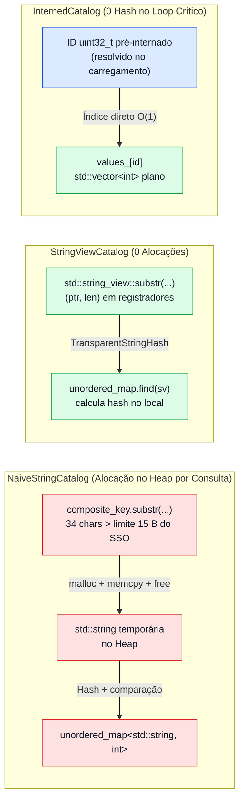

# String View, SSO e Interning de Strings

## Índice

- [Intuição: Fotocopiar vs. Apontar o Dedo vs. Número de Armário](#intuição-fotocopiar-vs-apontar-o-dedo-vs-número-de-armário)
- [Hardware e Layout de Memória](#hardware-e-layout-de-memória)
- [Passo a Passo do Código](#passo-a-passo-do-código)
  - [1. Abordagem Ingênua: `NaiveStringCatalog` (`std::string::substr`)](#1-abordagem-ingênua-naivestringcatalog-stdstringsubstr)
  - [2. Visão Sem Alocação: `StringViewCatalog` (`std::string_view` + Hash Transparente)](#2-visão-sem-alocação-stringviewcatalog-stdstring_view--hash-transparente)
  - [3. Resolução no Carregamento: `InternedCatalog` (IDs `uint32_t` Pré-Internados)](#3-resolução-no-carregamento-internedcatalog-ids-uint32_t-pré-internados)
- [Trade-offs e Armadilhas](#trade-offs-e-armadilhas)
- [Como Verificar e Fazer Profiling](#como-verificar-e-fazer-profiling)
- [Resumo](#resumo)

---

## Intuição: Fotocopiar vs. Apontar o Dedo vs. Número de Armário

Imagine um motor de jogos resolvendo 10.000 chaves de atributos por frame no formato `"combat_ns:entity_attribute_modifier_value_42"`. Você só precisa da parte após o `:` para buscar o valor no catálogo. Existem três formas de fazer isso:

1. **Fotocopiar (`std::string::substr`)**: Toda vez que precisa checar o sufixo, você compra um caderno novo (alocação no heap), copia os 34 caracteres para ele, entrega ao bibliotecário (`std::unordered_map::find`) e tritura o caderno logo em seguida. Fazer isso 2.000.000 de vezes desperdiça a maior parte do tempo conversando com o alocador de memória.
2. **Apontar com o dedo (`std::string_view`)**: Você mantém a string original intacta e apenas aponta dois dedos para ela — *comece aqui, leia 34 caracteres*. Nenhum caderno é comprado, nenhum caractere é copiado, e um **hash transparente** permite ao bibliotecário ler diretamente do trecho apontado.
3. **Números de armário (interning para `uint32_t`)**: Em vez de ler textos longos 10.000 vezes por frame, você pergunta ao bibliotecário uma única vez durante o carregamento da fase: *"Qual é o número do armário de `entity_attribute_modifier_value_42`?"* Ele responde `42`. Durante o loop do jogo, você vai direto ao armário `values_[42]` sem calcular hash nem comparar strings.

---

## Hardware e Layout de Memória

**Small String Optimization (SSO)** é uma otimização interna de `std::string`: em vez de sempre alocar memória no heap, `std::string` reserva um pequeno bolso interno dentro do próprio objeto. No `libstdc++` (x86_64), esse bolso comporta **até 15 caracteres**.

- Strings de `<= 15` bytes cabem dentro do objeto na stack (zero alocações no heap).
- Strings de `>= 16` bytes estouram o limite de SSO e forçam um par `malloc`/`free` no heap.

Nosso sufixo `"entity_attribute_modifier_value_<id>"` tem **33–34 bytes** — mais que o dobro do limite de 15 bytes do SSO:

```text
std::string (32 bytes no libstdc++ x86_64):
  <= 15 chars (cabe no SSO): [ char[16] interno | size ]              --> Sem alocação no heap!
  >= 16 chars (estoura SSO): [ ptr -> Buffer no Heap (malloc/free) | size | cap ]  --> Alocação no heap!

std::string_view (16 bytes, não-proprietária):
  [ const char* ptr | size_t len ]  --> Cabe em 2 registradores da CPU, 0 alocações no heap!
```



---

## Passo a Passo do Código

Todos os três catálogos estão em [`lessons/StringViewSso/include/string_lookup.hpp`](../include/string_lookup.hpp).

### 1. Abordagem Ingênua: `NaiveStringCatalog` (`std::string::substr`)

`NaiveStringCatalog::lookup` fatia o sufixo após `:` criando uma nova `std::string`:

```cpp
[[nodiscard]] int lookup(const std::string& composite_key) const {
    std::size_t colon = composite_key.find(':');
    if (colon == std::string::npos || colon + 1 >= composite_key.size()) {
        return -1;
    }
    std::string sub_key = composite_key.substr(colon + 1); // > 15 bytes: aloca no heap!
    auto it = table_.find(sub_key);
    return it != table_.end() ? it->second : -1;
}
```

Em `10.000` consultas ao longo de `200` frames (`2.000.000` buscas), `sub_key` dispara `2.000.000` alocações e liberações no heap (`86.858 ms`).

### 2. Visão Sem Alocação: `StringViewCatalog` (`std::string_view` + Hash Transparente)

Por padrão, `std::unordered_map<std::string, int>::find(sv)` **não** aceita `std::string_view` sem construir uma `std::string` temporária — anulando toda a otimização. Para habilitar **busca heterogênea** (consultar usando outro tipo de chave sem conversão), definimos `TransparentStringHash` com `using is_transparent = void;` junto com `std::equal_to<>`:

```cpp
struct TransparentStringHash {
    using is_transparent = void;
    [[nodiscard]] std::size_t operator()(std::string_view sv) const noexcept {
        return std::hash<std::string_view>{}(sv);
    }
};

// Dentro de StringViewCatalog:
std::unordered_map<std::string, int, TransparentStringHash, std::equal_to<>> table_;
```

Agora `StringViewCatalog::lookup` fatia em $O(1)$ ajustando apenas registradores, com **0 alocações no heap** (`39.524 ms`, `2.20x` mais rápido):

```cpp
std::string_view sub_key = composite_key.substr(colon + 1); // Ajusta só (ptr, len)
auto it = table_.find(sub_key); // Calcula hash de sub_key direto, sem std::string temporária
```

### 3. Resolução no Carregamento: `InternedCatalog` (IDs `uint32_t` Pré-Internados)

Calcular o hash de uma string de 34 bytes ainda percorre todos os caracteres em todo frame. O **interning de strings** tira esse trabalho do loop: no carregamento, `preintern_queries` converte cada string em um índice denso `uint32_t` via `intern_composite`. Em tempo de execução, `lookup_id` é uma simples leitura em array:

```cpp
[[nodiscard]] int lookup_id(std::uint32_t id) const noexcept {
    return id < values_.size() ? values_[id] : -1;
}
```

Eliminar o cálculo de hash por frame e a navegação nos buckets reduz o tempo para `0.900 ms` (`96.47x` mais rápido).

---

## Trade-offs e Armadilhas

### Quando NÃO Usar `std::string_view` ou Interning

- **`std::string_view` pendente (bugs de tempo de vida)**: `std::string_view` *não* é dona dos caracteres para os quais aponta. Nunca guarde uma `std::string_view` apontando para uma `std::string` temporária que será destruída, nem para uma `std::string` que possa realocar seu buffer.
- **Passar `sv.data()` para APIs em C**: Uma fatia de `std::string_view` (especialmente prefixos ou fatias internas) **não tem garantia de terminar em `'\0'`**. Nunca passe `sv.data()` para `printf("%s", ...)` ou `fopen()`.
- **Strings dinâmicas sem limite para interning**: Interning funciona melhor para conjuntos conhecidos e limitados de chaves (caminhos de assets, nomes de atributos, tags) resolvidos no carregamento. Internar mensagens de chat arbitrárias para sempre fará a tabela crescer indefinidamente.

---

## Como Verificar e Fazer Profiling

Compile e execute o benchmark, depois confirme zero alocações no caminho crítico com `heaptrack` ou `perf stat`:

```bash
cmake -S . -B build -DCMAKE_BUILD_TYPE=Release
cmake --build build --target string_view_sso_bench
./build/lessons/StringViewSso/string_view_sso_bench
perf stat -e cache-misses,instructions,branches ./build/lessons/StringViewSso/string_view_sso_bench
```

Para capturar erros de tempo de vida com `std::string_view` durante os testes, compile com AddressSanitizer (`-fsanitize=address,undefined`).

---

## Resumo

Carga de trabalho: `10.000` consultas de atributos compostos (`"combat_ns:entity_attribute_modifier_value_<id>"`) por frame ao longo de `200` frames (`2.000.000` buscas no total, `g++ -std=c++20 -O2`):

| Abordagem | Tempo Total (`200` frames) | Ganho vs. Baseline | Alocações no Heap (Caminho Crítico) |
|---|---:|---:|---:|
| `NaiveStringCatalog` (`std::string::substr`) | `86.858 ms` | `1.00x` | `2,000,000` |
| `StringViewCatalog` (`std::string_view` + hash transparente) | `39.524 ms` | `2.20x` | `0` |
| `InternedCatalog` (ID `uint32_t` pré-internado) | `0.900 ms` | `96.47x` | `0` |
