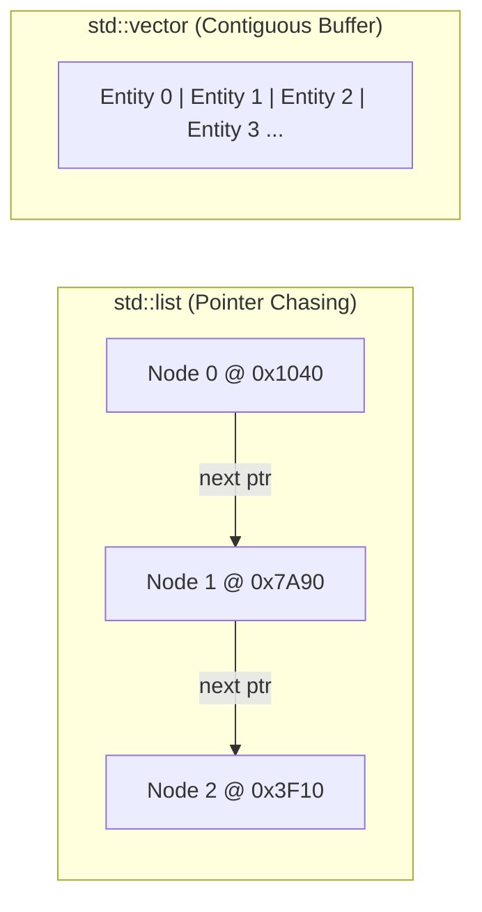

# Vector vs List (Swap-and-Pop Removal)

## Table of Contents

- [Intuition: The Classroom Roll Call](#intuition-the-classroom-roll-call)
- [Hardware and Memory Layout](#hardware-and-memory-layout)
- [Step-by-Step Code Walkthrough](#step-by-step-code-walkthrough)
- [Trade-offs and Pitfalls](#trade-offs-and-pitfalls)
- [How to Verify and Profile](#how-to-verify-and-profile)
- [Summary](#summary)

---

## Intuition: The Classroom Roll Call

Imagine checking attendance for 100 students. If every student sits in a row of connected desks (`std::vector`), you walk down the aisle from desk 1 to desk 100 in seconds. Now suppose student #12 leaves early. Shifting students #13 through #100 one seat to the left would take forever.

Instead, you ask student #100 in the very last seat to move into empty seat #12, and then you cross off the last seat. Nobody else moves, the row stays packed with zero empty gaps, and your next walk down the aisle is just as fast.

`std::list` tries to avoid shifting by giving every student a separate desk in a random room across the school, with sticky notes pointing to the next student's room (`prev` and `next` pointers). Removing a student only changes two sticky notes, but taking attendance forces you to sprint across different hallways for every single student.

---

## Hardware and Memory Layout

A modern CPU does not fetch single bytes from RAM; it pulls **64-byte cache lines** and relies on a **hardware prefetcher** that detects sequential address strides.

```text
std::list<Entity> (scattered heap nodes, 40 bytes each + allocator metadata)
[prev|next|Entity A] --(random jump)--> [prev|next|Entity B] --(random jump)--> [prev|next|Entity C]
  0x1040 (Cache Miss)                    0x7A90 (Cache Miss)                    0x3F10 (Cache Miss)

std::vector<Entity> (contiguous buffer, 20 bytes per Entity)
|<------------------ 64-byte Cache Line ------------------>|
| Entity 0 (20B) | Entity 1 (20B) | Entity 2 (20B) | E3..  |  --> Sequential stride prefetched!
```



In `entity_containers.hpp`, `Entity` is 20 bytes (`uint32_t id`, `float x, y, vx, vy`). Three full `Entity` structs fit inside a single 64-byte cache line in `std::vector`, while `std::list` wraps each `Entity` in a separate heap allocation with two 8-byte pointers (`prev` and `next`) plus allocator bookkeeping.

---

## Step-by-Step Code Walkthrough

In [`lessons/VectorVsList/include/entity_containers.hpp`](../include/entity_containers.hpp), three worlds implement `spawn`, `remove_at`, and `update_all`.

### 1. Naive Approach: `ListWorld`

`ListWorld` stores `std::list<Entity> entities_`. Removing at an index must walk from `begin()` with `std::advance(it, index)` ($O(n)$) before calling `entities_.erase(it)`:

```cpp
bool remove_at(std::size_t index) {
    if (index >= entities_.size()) {
        return false;
    }
    auto it = entities_.begin();
    std::advance(it, static_cast<std::ptrdiff_t>(index));
    entities_.erase(it);
    return true;
}
```

Every `update_all(dt)` iteration chases `next` pointers across the heap, causing L1/L2 cache misses.

### 2. Middle Ground: `DequeWorld`

`DequeWorld` uses `std::deque<Entity>` with swap-and-pop. `std::deque` allocates fixed-size blocks instead of per-node heap allocations, avoiding per-element pointers, though indexing still crosses a block map.

### 3. Optimized Approach: `VectorSwapPopWorld`

`VectorSwapPopWorld` keeps everything in one contiguous `std::vector<Entity>` and replaces `erase` with $O(1)$ **swap-and-pop**:

```cpp
bool remove_at(std::size_t index) noexcept {
    if (index >= entities_.size()) {
        return false;
    }
    if (index + 1 < entities_.size()) {
        entities_[index] = std::move(entities_.back());
    }
    entities_.pop_back();
    return true;
}
```

Because `entities_` never has holes, `update_all(dt)` streams linearly through memory at full hardware prefetcher speed.

---

## Trade-offs and Pitfalls

### When NOT to Use Swap-and-Pop

- **Order must be preserved**: Swap-and-pop scrambles element order. If draw order, Z-sorting, or FIFO queue order matters, use `std::vector::erase` (for rare removals) or re-sort periodically.
- **External pointers or indices**: Moving `entities_.back()` into `index` invalidates any saved pointer, reference, or raw index pointing to the last element. Use generational handles or a sparse-set indirection table if external systems hold references.
- **Expensive move assignment**: For huge non-trivial objects where moving costs more than a pointer swap, store lightweight handles or indices instead.

### When `std::list` Still Makes Sense

`std::list` (or an intrusive list) is justified when you already hold an iterator to the element, require strict pointer/iterator stability across insertions and deletions, and rarely iterate the full collection.

---

## How to Verify and Profile

Build and run the benchmark and inspect hardware cache-miss counters with `perf stat` or Valgrind Cachegrind:

```bash
cmake -S . -B build -DCMAKE_BUILD_TYPE=Release
cmake --build build --target vector_vs_list_bench
./build/lessons/VectorVsList/vector_vs_list_bench
perf stat -e cache-references,cache-misses,L1-dcache-load-misses ./build/lessons/VectorVsList/vector_vs_list_bench
```

On Linux, you can also inspect the hot `update_all` loop under Cachegrind (`valgrind --tool=cachegrind`) to confirm `D1mr` (L1 data read misses) drop sharply from `ListWorld` to `VectorSwapPopWorld`.

---

## Summary

Workload: `20` frames of `update_all(0.016f)` + `200` random removals/spawns per frame (`g++ 13.3.0 -O2`, Ryzen 7 5800X):

| Metric | `ListWorld` (`std::list`) | `DequeWorld` (`std::deque`) | `VectorSwapPopWorld` (`std::vector`) |
|---|---:|---:|---:|
| Time (`10,000` entities) | `30.302 ms` | `0.239 ms` | `0.165 ms` (`184.20x` faster) |
| Time (`100,000` entities) | `233.821 ms` | `3.044 ms` | `1.451 ms` (`161.17x` faster) |
| Removal complexity | $O(n)$ by index / $O(1)$ by iter | $O(1)$ (swap-and-pop) | $O(1)$ (swap-and-pop) |
| Memory overhead per entity | `16 B` (`prev`/`next`) + heap header | Minimal (chunk map) | `0 B` |
| Preserves order? | Yes | No | No |
