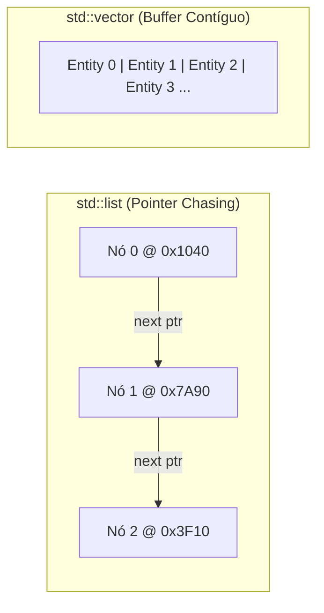

# Vector vs List (Remoção com Swap-and-Pop)

## Índice

- [Intuição: A Chamada na Sala de Aula](#intuição-a-chamada-na-sala-de-aula)
- [Hardware e Layout de Memória](#hardware-e-layout-de-memória)
- [Passo a Passo do Código](#passo-a-passo-do-código)
- [Trade-offs e Armadilhas](#trade-offs-e-armadilhas)
- [Como Verificar e Fazer Profiling](#como-verificar-e-fazer-profiling)
- [Resumo](#resumo)

---

## Intuição: A Chamada na Sala de Aula

Imagine fazer a chamada de 100 alunos. Se todos estiverem sentados em uma fileira contínua de carteiras (`std::vector`), você percorre o corredor da carteira 1 até a 100 em segundos. Agora suponha que o aluno #12 saia mais cedo. Empurrar os alunos #13 até #100 uma carteira para a esquerda levaria uma eternidade.

Em vez disso, você pede ao aluno #100 da última carteira para se sentar na carteira #12, e apaga a última vaga da lista. Ninguém mais se move, a fileira continua compacta sem buracos e a próxima chamada continua tão rápida quanto antes.

O `std::list` tenta evitar o deslocamento colocando cada aluno em uma sala separada pela escola, com bilhetes apontando para a sala do próximo aluno (`prev` e `next`). Remover alguém só muda dois bilhetes, mas fazer a chamada obriga você a correr por corredores diferentes a cada aluno.

---

## Hardware e Layout de Memória

Uma CPU moderna não lê bytes isolados da RAM; ela busca **linhas de cache de 64 bytes** e conta com um **hardware prefetcher** que detecta acessos sequenciais.

```text
std::list<Entity> (nós espalhados no heap, 40 bytes cada + metadados do alocador)
[prev|next|Entity A] --(salto aleatório)--> [prev|next|Entity B] --(salto aleatório)--> [prev|next|Entity C]
  0x1040 (Cache Miss)                        0x7A90 (Cache Miss)                        0x3F10 (Cache Miss)

std::vector<Entity> (buffer contíguo, 20 bytes por Entity)
|<------------------ Cache Line de 64 bytes ------------------>|
| Entity 0 (20B) | Entity 1 (20B) | Entity 2 (20B) | E3..     |  --> Stride sequencial com prefetch!
```



Em `entity_containers.hpp`, `Entity` ocupa 20 bytes (`uint32_t id`, `float x, y, vx, vy`). Três structs `Entity` cabem inteiras dentro de uma única cache line de 64 bytes no `std::vector`, enquanto `std::list` envolve cada `Entity` em uma alocação separada no heap com dois ponteiros de 8 bytes (`prev` e `next`) além do cabeçalho do alocador.

---

## Passo a Passo do Código

Em [`lessons/VectorVsList/include/entity_containers.hpp`](../include/entity_containers.hpp), três classes implementam `spawn`, `remove_at` e `update_all`.

### 1. Abordagem Ingênua: `ListWorld`

`ListWorld` usa `std::list<Entity> entities_`. Remover por índice exige caminhar desde `begin()` com `std::advance(it, index)` ($O(n)$) antes de chamar `entities_.erase(it)`:

```cpp
bool remove_at(std::size_t index) {
    if (index >= entities_.size()) {
        return false;
    }
    auto it = entities_.begin();
    std::advance(it, static_cast<std::ptrdiff_t>(index));
    entities_.erase(it);
    return true;
}
```

A cada frame, `update_all(dt)` persegue ponteiros `next` pelo heap, gerando cache misses constantes em L1/L2.

### 2. Meio-Termo: `DequeWorld`

`DequeWorld` usa `std::deque<Entity>` com swap-and-pop. O `std::deque` aloca blocos de tamanho fixo em vez de um nó por elemento, evitando ponteiros individuais, mas a indexação ainda passa por um mapa de blocos.

### 3. Abordagem Otimizada: `VectorSwapPopWorld`

`VectorSwapPopWorld` mantém tudo em um único `std::vector<Entity>` contíguo e troca `erase` pelo padrão **swap-and-pop** em $O(1)$:

```cpp
bool remove_at(std::size_t index) noexcept {
    if (index >= entities_.size()) {
        return false;
    }
    if (index + 1 < entities_.size()) {
        entities_[index] = std::move(entities_.back());
    }
    entities_.pop_back();
    return true;
}
```

Como `entities_` nunca fica com lacunas, `update_all(dt)` percorre a memória linearmente na velocidade máxima do prefetcher de hardware.

---

## Trade-offs e Armadilhas

### Quando NÃO Usar Swap-and-Pop

- **Quando a ordem importa**: Swap-and-pop embaralha os elementos. Se ordem de desenho, ordenação por profundidade ou fila FIFO forem obrigatórias, use `std::vector::erase` (para remoções raras) ou reordene periodicamente.
- **Ponteiros ou índices externos**: Mover `entities_.back()` para `index` invalida qualquer ponteiro, referência ou índice salvo que apontava para o último elemento. Use handles geracionais ou uma tabela de indireção (sparse set) se outros sistemas guardam referências.
- **Cópia/movimento caro**: Para objetos enormes não triviais, armazenar handles ou índices leves costuma ser melhor do que mover o objeto inteiro.

### Quando `std::list` Ainda Faz Sentido

`std::list` (ou uma lista intrusiva) se justifica quando você já tem o iterador do elemento em mãos, precisa de estabilidade estrita de ponteiros/iteradores durante inserções e remoções e raramente itera a coleção inteira.

---

## Como Verificar e Fazer Profiling

Compile e execute o benchmark e inspecione os contadores de cache miss com `perf stat` ou Valgrind Cachegrind:

```bash
cmake -S . -B build -DCMAKE_BUILD_TYPE=Release
cmake --build build --target vector_vs_list_bench
./build/lessons/VectorVsList/vector_vs_list_bench
perf stat -e cache-references,cache-misses,L1-dcache-load-misses ./build/lessons/VectorVsList/vector_vs_list_bench
```

No Linux, você também pode rodar `valgrind --tool=cachegrind` para confirmar a queda acentuada de `D1mr` (faltas de leitura no cache L1) do `ListWorld` para o `VectorSwapPopWorld`.

---

## Resumo

Carga: `20` frames de `update_all(0.016f)` + `200` remoções/inserções aleatórias por frame (`g++ 13.3.0 -O2`, Ryzen 7 5800X):

| Métrica | `ListWorld` (`std::list`) | `DequeWorld` (`std::deque`) | `VectorSwapPopWorld` (`std::vector`) |
|---|---:|---:|---:|
| Tempo (`10.000` entidades) | `30.302 ms` | `0.239 ms` | `0.165 ms` (`184.20x` mais rápido) |
| Tempo (`100.000` entidades) | `233.821 ms` | `3.044 ms` | `1.451 ms` (`161.17x` mais rápido) |
| Complexidade de remoção | $O(n)$ por índice / $O(1)$ por iter | $O(1)$ (swap-and-pop) | $O(1)$ (swap-and-pop) |
| Overhead por entidade | `16 B` (`prev`/`next`) + header | Mínimo (mapa de blocos) | `0 B` |
| Preserva ordem? | Sim | Não | Não |
